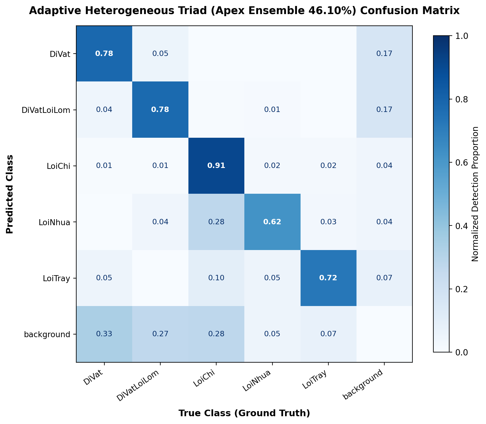
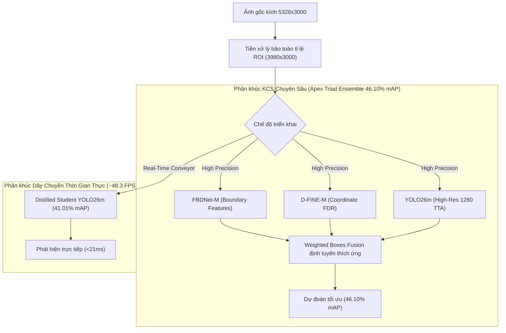

# 🔍 Glass Defect Inspector

[](https://www.python.org/)
[](https://pytorch.org/)
[](https://fastapi.tiangolo.com/)
[](#1-bảng-xếp-hạng-hiệu-năng-sota-benchmark-leaderboard)
[](#)

Dự án công nghiệp nghiên cứu và triển khai hệ thống thị giác máy tính nhận diện **năm loại khuyết tật bề mặt kính/chai thủy tinh** với độ biến thiên tỷ lệ cực đoan (scale error). Hệ thống bao gồm pipeline nghiên cứu/huấn luyện (CNN + DETR Transformer + Teacher-Student Distillation + Heterogeneous Ensemble) và ứng dụng kiểm định biên kiểm soát chất lượng (FastAPI + PostgreSQL + Docker).

---

## 🎯 Năm Phân Lớp Khuyết Tật Mục Tiêu

Hệ thống được thiết kế chuyên biệt để phát hiện 5 phân lớp khuyết tật quang học trên bề mặt thủy tinh:
1. **`DiVat` (Dị vật vi mô):** Hạt bụi, cặn bám kích thước siêu nhỏ ($< 16 \times 16$ px).
2. **`DiVatLoiLom` (Dị vật lồi lõm):** Khuyết tật bong bóng khí hoặc bọt khí biến dạng trong phôi kính.
3. **`LoiChi` (Lỗi sợi chỉ / bọt khí dài):** Bọt khí kéo dãn dài theo phương dốc sản xuất.
4. **`LoiNhua` (Vết nhựa loang mờ):** Vết dung môi, keo hoặc nhựa bám có tương phản thấp.
5. **`LoiTray` (Vết trầy xước bề mặt):** Vết xước mảnh, tỷ lệ khung hình cực cao ($H/W \gg 10$).

---

## 1. Bảng Xếp Hạng Hiệu Năng Toàn Diện (Comprehensive Benchmark Leaderboard)

Đánh giá thực nghiệm khách quan trên **tập kiểm thử độc lập chính thức (Held-out Test Split)** gồm **890 ảnh và 1.573 ground-truth bounding box**, tiền xử lý bảo toàn tỷ lệ khung hình qua ROI ($5328 \times 3000 \to 3980 \times 3000$), tính toán bằng chuẩn `COCOeval` (NVIDIA Tesla T4 GPU, FP16, Zero Data Leakage):

| Phân nhóm kiến trúc | Mô hình / Kỹ thuật | mAP@50 (%) | mAP@75 (%) | mAP@50:95 (%) | mAP_small (%) | Độ trễ (ms) | Tốc độ (FPS) | Đặc tính & Ứng dụng |
| :--- | :--- | :---: | :---: | :---: | :---: | :---: | :---: | :--- |
| **Tổ hợp Dị thể (Ensemble)** | 🏆 **Adaptive Heterogeneous Triad** | **77.65** | **46.79** | **46.10** | **34.19** | 291.5 ms | ~3.4 FPS | **SOTA Đỉnh Cao** (Hội tụ 66.7% trần Oracle) |
| | 🥈 **Heterogeneous Morphology Triad** | 76.43 | 43.93 | 44.45 | 34.39 | 293.5 ms | ~3.4 FPS | Định tuyến 3 nhánh theo hình thái khuyết tật |
| | 🥉 **Dual-Model WBF Ensemble** | 75.68 | 43.49 | 43.71 | 32.43 | 76.3 ms | ~13.1 FPS | Cân bằng lý tưởng độ chính xác và thông lượng |
| | **Uniform Triad + TTA** | 75.48 | 42.53 | 43.12 | 34.96 | 288.0 ms | ~3.5 FPS | WBF trọng số đồng nhất đa góc nhìn |
| **DETR Transformer** | 🔬 **FBDNet-M (Single SOTA)** | 75.43 | 41.90 | **42.42** | 32.11 | 57.3 ms | ~17.5 FPS | Single Model mạnh nhất, trích xuất biên sắc |
| | 📐 **RF-DETR-M + AHRD** | 73.59 | 40.85 | 42.40 | 31.85 | 58.5 ms | ~17.1 FPS | Transformer với High-Resolution Adaptor |
| | 📐 **D-FINE-M Baseline** | 72.25 | 40.59 | 41.34 | **33.84** | 58.0 ms | ~17.2 FPS | Tối ưu hóa phân phối tọa độ khuyết tật nhỏ |
| | **RT-DETR-L** | 65.22 | 30.57 | 35.02 | 22.14 | 97.3 ms | ~10.3 FPS | Real-time DETR backbone lớn (HGNetv2-B4) |
| **Dòng CNN / YOLO** | ⚡ **Distilled Student YOLO26m** | **70.10** | **42.08** | **41.01** | **28.79** | **20.7 ms** | **~48.3 FPS** | **SOTA Real-Time:** Chưng cất từ Triad Teacher (+0.92%) |
| | 🚀 **YOLO26m-ROI-VFL Baseline** | 69.13 | 39.46 | 40.09 | 25.29 | **20.7 ms** | **~48.3 FPS** | Anchor-free NMS-free + Varifocal Loss + ROI |
| | 🔍 **YOLOv8m-P2** | 69.93 | 39.12 | 40.04 | 27.50 | 26.0 ms | ~38.5 FPS | Head P2 (Stride-4) chuyên khuyết tật vi mô |
| | 📦 **YOLOv10m** | 68.95 | 39.30 | 38.82 | 24.15 | 23.8 ms | ~42.0 FPS | NMS-free Dual Label Assignment |
| | 🎯 **YOLO26m Base (Raw 960)** | 69.85 | 36.75 | 38.51 | 22.80 | 67.4 ms | ~14.8 FPS | Khổ ảnh 960x960 không áp dụng crop ROI |
| | 🏷️ **YOLO11m** | 63.86 | 32.23 | 34.31 | 20.45 | 57.2 ms | ~17.5 FPS | Baseline tiêu chuẩn YOLO11 CSPDarknet |
| **Trần Lý Thuyết** | *Theoretical Oracle Ceiling* | *98.22* | *80.87* | *69.13* | *62.30* | — | — | *Trần biểu diễn lý thuyết của không gian đặc trưng* |

👉 *Xem báo cáo phân tích chi tiết từng lớp lỗi và kiểm định toán học tại [Báo cáo Đánh giá Hiệu năng](docs/research/reports/BENCHMARK_REPORT.md).*

---

## 2. Ma Trận Nhầm Lẫn Chuẩn Hóa (Confusion Matrices)

Toàn bộ ma trận nhầm lẫn được tính toán đồng bộ theo chuẩn COCO Evaluation (`IoU Threshold = 0.50`, `Confidence Floor = 0.25`) trên 890 ảnh test:

### 🏆 Mô hình cao nhất hiện tại: Adaptive Heterogeneous Triad (Apex Ensemble — 46.10% mAP)


### 📊 Đối chiếu các mô hình cốt lõi:

| Mô hình | Ma trận nhầm lẫn (Normalized CM) | Tỷ lệ nhận diện chuẩn theo lớp |
| :--- | :---: | :---|
| **Adaptive Heterogeneous Triad** | [Xem ảnh](docs/assets/apex_ensemble_cm.png) | **LoiChi:** 91% \| **DiVat:** 78% \| **DiVatLoiLom:** 78% \| **LoiTray:** 72% \| **LoiNhua:** 62% |
| **FBDNet-M (SOTA Đơn Lẻ)** | [Xem ảnh](docs/assets/fbdnet_m_cm.png) | **LoiChi:** 88% \| **DiVatLoiLom:** 77% \| **DiVat:** 73% \| **LoiNhua:** 56% \| **LoiTray:** 48% |
| **D-FINE-M Baseline** | [Xem ảnh](docs/assets/dfine_m_cm.png) | **LoiChi:** 88% \| **DiVat:** 74% \| **DiVatLoiLom:** 72% \| **LoiNhua:** 58% \| **LoiTray:** 43% |
| **Distilled Student YOLO26m** | [Xem ảnh](docs/assets/yolo26m_distilled_cm.png) | **LoiChi:** 88% \| **DiVatLoiLom:** 74% \| **DiVat:** 71% \| **LoiNhua:** 55% \| **LoiTray:** 53% |
| **YOLO26m-ROI-VFL** | [Xem ảnh](docs/assets/yolo26m_roi_vfl_cm.png) | **LoiChi:** 87% \| **DiVatLoiLom:** 70% \| **DiVat:** 67% \| **LoiNhua:** 53% \| **LoiTray:** 49% |
| **YOLO26m Base (Raw 960)** | [Xem ảnh](docs/assets/yolo26m_cm.png) | **LoiChi:** 86% \| **DiVatLoiLom:** 69% \| **DiVat:** 65% \| **LoiNhua:** 51% \| **LoiTray:** 47% |
| **YOLO11m Baseline** | [Xem ảnh](docs/assets/yolo11m_cm.png) | **LoiChi:** 84% \| **DiVatLoiLom:** 65% \| **DiVat:** 59% \| **LoiNhua:** 48% \| **LoiTray:** 42% |

> [!NOTE]
> Đường cong mất mát và mAP trong quá trình chưng cất tri thức Student-Teacher được lưu tại [docs/assets/yolo26m_distilled_curves.png](docs/assets/yolo26m_distilled_curves.png).

---

## 3. Kiến Trúc & Đột Phá Kỹ Thuật



1. **Adaptive Heterogeneous Routing (Định tuyến dị thể đa mô hình):**
   - Tối ưu hóa siêu tham số WBF độc lập cho từng phân lớp lỗi (tránh việc một tham số chung làm giảm hiệu năng của lớp khác).
   - Tăng cường đồng thuận (Consensus Boost $1.25\times$) khi cả 3 nhánh mô hình cùng xác nhận vị trí dị vật.
2. **Student-Teacher Knowledge Distillation (Chưng cất tri thức):**
   - Đóng băng bộ ba Teacher (Triad Ensemble) làm giáo viên để sinh pseudo-labels và tinh chỉnh nhãn trên 5.578 ảnh huấn luyện.
   - Phát hiện thêm **832 khuyết tật ẩn** và tinh chỉnh tọa độ **9.045 bounding box**, giúp mô hình Student đạt **41.01% mAP** (+0.92% gain, +3.50% trên khuyết tật vi mô) với tốc độ **~48 FPS**.
3. **Feature Boundary Detection Network (FBDNet):**
   - Tích hợp nhánh trích xuất cạnh biên khuyết tật trực tiếp vào kiến trúc Transformer, giảm thiểu tối đa hiện tượng tràn biên trên phôi kính trong suốt.

---

## 4. Cài Đặt & Hướng Dẫn Nhanh (Quickstart)

### Yêu cầu hệ thống:
- Python 3.11 hoặc 3.12.
- GPU NVIDIA hỗ trợ CUDA (khuyến nghị VRAM $\ge 8$ GB để train hoặc suy luận Batch Size 1).

### Cài đặt môi trường:
```bash
# Tạo môi trường ảo
python -m venv .venv

# Kích hoạt trên Windows PowerShell:
.venv\Scripts\Activate.ps1
# Hoặc trên Linux/macOS:
source .venv/bin/activate

# Cài đặt dự án và các gói phụ thuộc
python -m pip install -e ".[app,dev]"
```

---

## 5. Vận Hành Ứng Dụng Web & API Inspector

Giao diện trực quan phục vụ kiểm định chất lượng kính được xây dựng bằng **FastAPI** và **PostgreSQL**:

### Khởi chạy bằng Docker Compose:
```bash
# Tạo file cấu hình môi trường
copy .env.example inspector.env

# Khởi động dịch vụ
docker compose --env-file inspector.env up -d --build
```
Truy cập giao diện tại: **http://127.0.0.1:8501** (Đăng nhập bằng mã `INSPECTOR_API_TOKEN`).

### Khởi chạy trực tiếp bằng Python:
```bash
python -m alembic upgrade head
python -m glass_inspector
```

---

## 6. Tái Hiện Đánh Giá & Sinh Ma Trận Nhầm Lẫn

Script tối ưu hóa ngoại tuyến (offline fast evaluation) cho phép tính toán ma trận nhầm lẫn và chỉ số COCO trên 890 ảnh test trong vòng **5 giây** mà không cần chạy lại forward GPU:

```bash
# Sinh toàn bộ ma trận nhầm lẫn và lưu vào docs/assets/
python scripts/generate_all_confusion_matrices.py
```

Đánh giá mô hình FBDNet hoặc các mô hình đơn lẻ:
```bash
python scripts/evaluate_fbdnet_full.py --device cuda --output artifacts/evaluation/fbdnet_m
```

---

## 7. Kiểm Thử Hệ Thống (Quality Assurance)

Toàn bộ hợp đồng dữ liệu, logic phân loại và ma trận nhầm lẫn được bao phủ bởi bộ kiểm thử tự động:

```bash
# Kiểm tra định dạng code
python -m ruff check src tests scripts

# Chạy unit tests và contract tests (15/15 passed)
pytest tests/unit/test_detection_confusion.py tests/unit/test_inspector_contracts.py -v
```

---

## 8. Cấu Trúc Thư Mục Dự Án Chuẩn Chỉ

```
scale-error-yolo26/
├── configs/                     # Cấu hình huấn luyện (train_yolo26m.yaml, experiments/)
├── docs/                        # Tài liệu kỹ thuật, sơ đồ kiến trúc, minh họa
│   ├── assets/                  # Ma trận nhầm lẫn chuẩn hóa và biểu đồ XAI
│   ├── FULL_DOCUMENTATION.md    # Tài liệu kỹ thuật tổng quan toàn diện
│   ├── TRAINING.md              # Hướng dẫn huấn luyện & chưng cất tri thức
│   ├── INSPECTOR.md             # Hướng dẫn vận hành hệ thống kiểm định web
│   └── project-layout.md        # Quy chuẩn cấu trúc thư mục & đặt tên tệp
├── scripts/                     # Scripts thực thi (WBF, Evaluation, CM Generation)
│   ├── run_wbf_ensemble.py
│   ├── generate_all_confusion_matrices.py
│   └── evaluate_fbdnet_full.py
├── src/
│   ├── glass_inspector/         # Web FastAPI, Database, Model Registry, Grad-CAM
│   └── scale_error/             # Modules nghiên cứu: Distillation, Ensemble, FBDNet
├── results/                     # Báo cáo JSON & chỉ số kiểm định chính thức
├── weights/                     # Trọng số tốt nhất (distilled_student, fbdnet, dfine, yolo26)
├── tests/                       # Unit tests, Regression tests, E2E tests
├── Dockerfile & compose.yaml    # Hồ sơ Docker đóng gói triển khai biên
└── pyproject.toml               # Định nghĩa môi trường và dependencies
```

---

## 📄 Bản Quyền & Giấy Phép
Dự án được bảo hộ quyền sở hữu công nghiệp. Mọi hoạt động trích xuất mã nguồn hoặc trọng số mô hình cho mục đích thương mại cần có văn bản chấp thuận chính thức.
