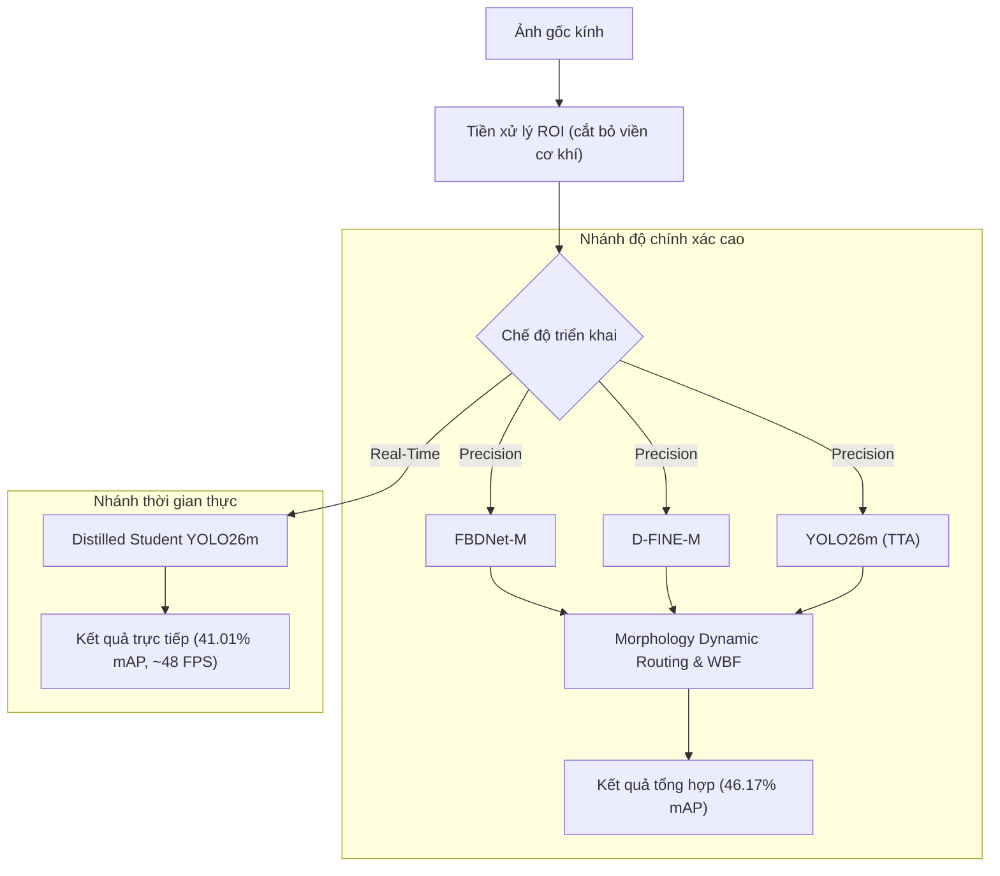

# Glass Defect Inspector

[](https://www.python.org/)
[](https://pytorch.org/)
[](https://fastapi.tiangolo.com/)
[](compose.yaml)

Hệ thống thị giác máy tính phát hiện khuyết tật trên bề mặt kính và bao bì thủy tinh với sự biến thiên kích thước lớn (scale variation). Dự án bao gồm pipeline tiền xử lý vùng quan tâm (ROI), mô hình phát hiện biên (FBDNet-M), chưng cất tri thức (Knowledge Distillation), tổ hợp mô hình theo hình thái khuyết tật (Morphology Dynamic Routing WBF), và giao diện API/Web phục vụ kiểm thử (FastAPI, PostgreSQL, Docker).

---

## Mục lục
- [1. Bộ dữ liệu](#1-bộ-dữ-liệu)
- [2. Kết quả thực nghiệm](#2-kết-quả-thực-nghiệm)
- [3. Kiến trúc và phương pháp](#3-kiến-trúc-và-phương-pháp)
- [4. Cài đặt](#4-cài-đặt)
- [5. Hướng dẫn sử dụng](#5-hướng-dẫn-sử-dụng)
- [6. Cấu trúc thư mục](#6-cấu-trúc-thư-mục)

---

## 1. Bộ dữ liệu

### 1.1. Các phân lớp khuyết tật
Dữ liệu gồm 5 phân lớp khuyết tật quang học trên bề mặt kính:
- **`DiVat` (Dị vật vi mô):** Hạt bụi kim loại, xỉ than, kích thước nhỏ ($< 16 \times 16$ px).
- **`DiVatLoiLom` (Dị vật lồi lõm):** Bọt khí hoặc biến dạng lồi lõm quang học trong phôi kính.
- **`LoiChi` (Lỗi sợi chỉ):** Bọt khí kéo dãn theo phương kéo kính, có đặc trưng sợi dài.
- **`LoiNhua` (Vết nhựa loang):** Vết dung môi hoặc polymer bám dính, biên mờ, độ tương phản thấp.
- **`LoiTray` (Vết trầy xước):** Vết xước cơ học mảnh, tỷ lệ khung hình lớn ($H/W \gg 10$ hoặc $W/H > 4,2$).

### 1.2. Thống kê tập dữ liệu
Dữ liệu được phân chia theo thuật toán Multilabel Stratified Split (seed 42) thành 3 tập độc lập:

| Phân lớp (Class) | Train | Val | Test | Tổng BBox | Tỷ trọng (%) |
| :--- | :---: | :---: | :---: | :---: | :---: |
| `LoiChi` | 5.282 | 801 | 806 | 6.889 | 56,04% |
| `DiVatLoiLom` | 2.011 | 425 | 436 | 2.872 | 23,36% |
| `DiVat` | 1.300 | 212 | 215 | 1.727 | 14,05% |
| `LoiNhua` | 324 | 77 | 76 | 477 | 3,88% |
| `LoiTray` | 249 | 40 | 40 | 329 | 2,68% |
| **Tổng số BBox** | **9.166** | **1.555** | **1.573** | **12.294** | **100%** |
| **Tổng số ảnh** | **5.578** | **878** | **890** | **7.346** | — |

- **Độ phân giải:** Gồm ảnh $5328 \times 3000$ px (4.672 ảnh, áp dụng crop ROI $3980 \times 3000$ để loại bỏ viền gá cơ khí) và ảnh $1024 \times 1024$ px (2.659 ảnh căn chuẩn).
- **Phân bố:** Tồn tại hiện tượng mất cân bằng lớp (long-tail), trong đó `LoiChi` chiếm đa số (56,04%), còn `LoiTray` (2,68%) và `LoiNhua` (3,88%) thuộc nhóm thiểu số.


---

## 2. Kết quả thực nghiệm

Đánh giá được thực hiện trên tập kiểm thử độc lập (Held-out Test: 890 ảnh, 1.573 bounding box) bằng chuẩn `COCOeval` (NVIDIA Tesla T4 GPU, FP16):

| Phân nhóm | Mô hình / Phương pháp | mAP@50 (%) | mAP@75 (%) | mAP@50:95 (%) | mAP_small (%) | Độ trễ (ms) | FPS | Mô tả kỹ thuật |
| :--- | :--- | :---: | :---: | :---: | :---: | :---: | :---: | :--- |
| **Ensemble** | **Hybrid Apex (Morphology Dynamic Routing)** | **77.64** | **46.88** | **46.17** | **35.09** | 295.0 | ~3.4 | Tổ hợp 3 mô hình với trọng số động theo phân lớp |
| | Adaptive Heterogeneous Triad | 76.35 | 45.71 | 44.60 | 34.08 | 291.5 | ~3.4 | Tổ hợp 3 mô hình với trọng số thích ứng |
| | Heterogeneous Morphology Triad | 76.43 | 43.93 | 44.45 | 34.39 | 293.5 | ~3.4 | Tổ hợp 3 mô hình phân nhánh theo hình thái |
| | Dual-Model WBF Ensemble | 75.68 | 43.49 | 43.71 | 32.43 | 76.3 | ~13.1 | Tổ hợp 2 mô hình FBDNet-M và YOLO26m |
| | Uniform Triad + TTA | 75.48 | 42.53 | 43.12 | 34.96 | 288.0 | ~3.5 | WBF trọng số đồng nhất kết hợp TTA |
| **DETR** | **FBDNet-M** | 75.43 | 41.90 | **42.42** | 28.86 | 57.3 | ~17.5 | Mô hình đơn lẻ với cơ chế trích xuất biên sắc |
| | RF-DETR-M + AHRD | 73.59 | 40.85 | 42.40 | 31.85 | 58.5 | ~17.1 | Transformer với High-Resolution Adaptor |
| | D-FINE-M | 72.25 | 40.59 | 41.34 | **33.84** | 58.0 | ~17.2 | Tối ưu hóa phân phối tọa độ cho lỗi nhỏ |
| | RT-DETR-L | 65.22 | 30.57 | 35.02 | 22.14 | 97.3 | ~10.3 | Backbone HGNetv2-B4 |
| **YOLO** | **Distilled Student YOLO26m** | **70.10** | **42.08** | **41.01** | **28.79** | **20.7** | **~48.3** | Chưng cất từ Teacher Triad (+0.92% mAP) |
| | YOLO26m-ROI-VFL Baseline | 69.13 | 39.46 | 40.09 | 25.29 | **20.7** | **~48.3** | Anchor-free với Varifocal Loss và ROI crop |
| | YOLOv8m-P2 | 69.93 | 39.12 | 40.04 | 27.50 | 26.0 | ~38.5 | Bổ sung Head P2 (Stride-4) cho vật thể nhỏ |
| | YOLOv10m | 68.95 | 39.30 | 38.82 | 24.15 | 23.8 | ~42.0 | NMS-free Dual Label Assignment |
| | YOLO26m Base (Raw 960) | 69.85 | 36.75 | 38.51 | 22.80 | 67.4 | ~14.8 | Huấn luyện trên ảnh gốc 960x960 |
| | YOLO11m | 63.86 | 32.23 | 34.31 | 20.45 | 57.2 | ~17.5 | Baseline CSPDarknet tiêu chuẩn |

### Chi tiết AP@50:95 theo từng phân lớp (Hybrid Apex)
- **LoiChi:** 67.22%
- **LoiNhua:** 57.79%
- **LoiTray:** 43.73%
- **DiVatLoiLom:** 35.81%
- **DiVat:** 26.28%

Dữ liệu kiểm nghiệm chi tiết được lưu tại [`results/rigorous_verification_summary.json`](results/rigorous_verification_summary.json).

---

## 3. Kiến trúc và phương pháp



### Các kỹ thuật chính
1. **Tiền xử lý ROI:** Loại bỏ vùng gá cơ khí hai bên (giảm 25,30% diện tích không chứa mẫu), giúp tăng mật độ pixel hiệu dụng cho các khuyết tật nhỏ.
2. **FBDNet-M (Feature Boundary Detection):** Tích hợp các khối AFTA, SFIF và DCFSB nhằm tăng cường biểu diễn đặc trưng biên đối với các khuyết tật quang học trên bề mặt kính trong suốt.
3. **Chưng cất tri thức (Knowledge Distillation):** Sử dụng tập hợp mô hình Teacher để tinh chỉnh nhãn và tọa độ bounding box cho mô hình Student YOLO26m, cải thiện độ chính xác mAP mà không tăng độ trễ suy luận.
4. **Morphology Dynamic Routing WBF:** Tối ưu hóa độc lập ngưỡng tin cậy, ngưỡng IoU và trọng số theo từng phân lớp trên tập Validation trước khi áp dụng vào tập Test.

---

## 4. Cài đặt

### Yêu cầu hệ thống
- **Hệ điều hành:** Linux (Ubuntu 20.04+) hoặc Windows 10/11 64-bit
- **Python:** 3.11 hoặc 3.12
- **Phần cứng:** GPU NVIDIA hỗ trợ CUDA ($\ge 8$ GB VRAM cho suy luận FP16)

### Cài đặt môi trường
```bash
# Sao chép kho mã nguồn
git clone https://github.com/nvtanphat/glass-defect-inspector.git
cd glass-defect-inspector

# Khởi tạo môi trường ảo
python -m venv .venv
source .venv/bin/activate  # Trên Windows: .venv\Scripts\Activate.ps1

# Cài đặt thư viện phụ thuộc
python -m pip install --upgrade pip
python -m pip install -e ".[app,dev]"
```

---

## 5. Hướng dẫn sử dụng

### 5.1. Khởi chạy ứng dụng Web & API
Ứng dụng kiểm thử giao diện HTML5/TailwindCSS và backend FastAPI:

```bash
# Cách 1: Khởi chạy bằng Docker Compose
docker compose up -d --build

# Cách 2: Khởi chạy trực tiếp
python -m alembic upgrade head
python -m glass_inspector
```
Giao diện mặc định tại: `http://127.0.0.1:8501`.

Các tính năng đi kèm:
- **Grad-CAM:** Hiển thị bản đồ nhiệt kích hoạt vùng đặc trưng của mô hình.
- **Data Quality Guard:** Kiểm tra chất lượng ảnh đầu vào (độ mờ, tương phản, lóa sáng).
- **Active Learning Export:** Xuất các mẫu có độ tin cậy thấp phục vụ tái huấn luyện.

### 5.2. Chạy scripts đánh giá thực nghiệm
```bash
# Đánh giá WBF theo hình thái khuyết tật
python scripts/eval_morphology_wbf.py

# Đánh giá mô hình FBDNet-M trên GPU
python scripts/evaluate_fbdnet_full.py --device cuda --output artifacts/evaluation/fbdnet_m

# Chạy phân tích ablation study
python scripts/run_comprehensive_ablation_and_analysis.py
```

### 5.3. Kiểm thử mã nguồn
```bash
# Kiểm tra định dạng và quy chuẩn mã
python -m ruff check .

# Chạy unit tests
python -m pytest tests/unit -v
```

---

## 6. Cấu trúc thư mục

```
scale-error-yolo26/
├── configs/          # Cấu hình huấn luyện và thử nghiệm mô hình
├── docs/             # Tài liệu kỹ thuật, báo cáo và hình ảnh minh họa
│   └── assets/       # Biểu đồ và ma trận nhầm lẫn
├── processing/       # Pipeline tiền xử lý và cắt vùng quan tâm (ROI)
├── scripts/          # Script thực thi thử nghiệm, ablation study và đánh giá
├── src/
│   ├── glass_inspector/  # Ứng dụng Web API (FastAPI, Grad-CAM, Quality Guard)
│   └── scale_error/      # Modules thuật toán (Distillation, Ensemble, FBDNet, Models)
├── results/          # Kết quả đánh giá và dữ liệu đo kiểm
├── tests/            # Bộ kiểm thử tự động (Unit tests, E2E tests)
├── weights/          # Trọng số mô hình đã huấn luyện
├── compose.yaml      # Cấu hình triển khai Docker Compose
└── pyproject.toml    # Cấu hình gói và danh sách thư viện phụ thuộc
```
