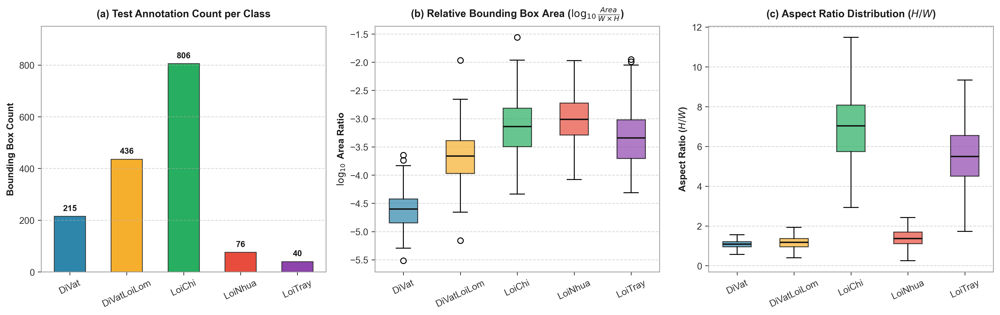
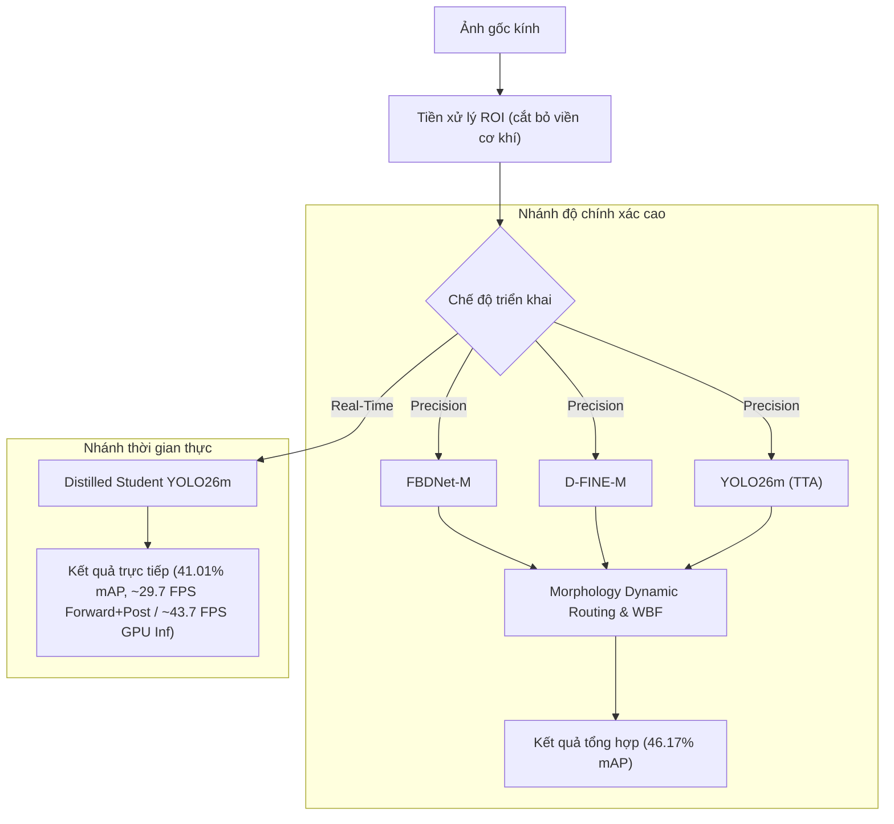
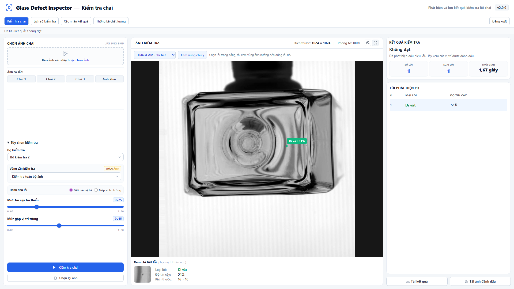
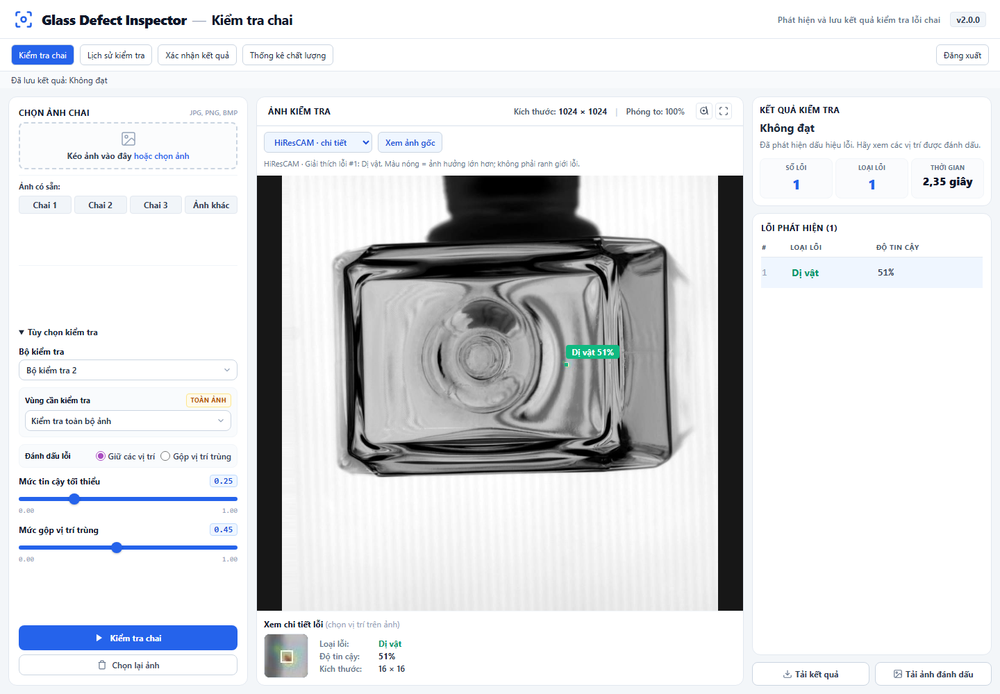
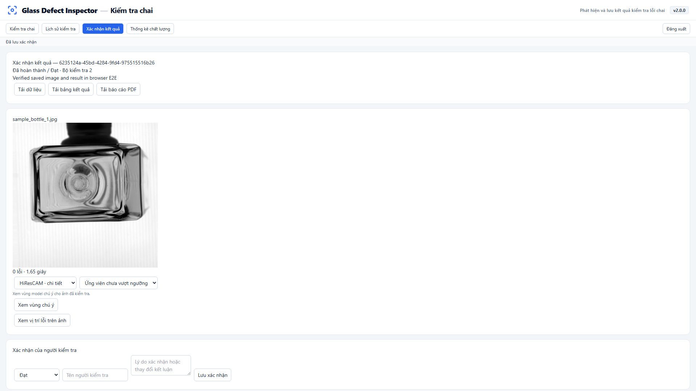
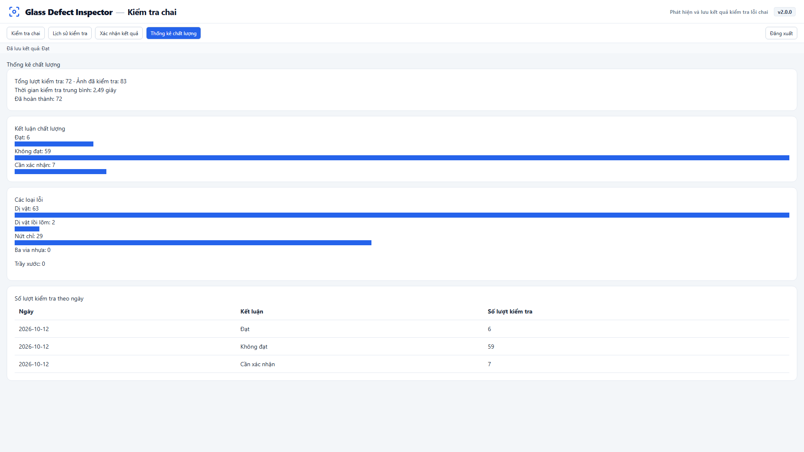

# Glass Defect Inspector

[](https://www.python.org/)
[](https://pytorch.org/)
[](https://fastapi.tiangolo.com/)
[](compose.yaml)

Hệ thống thị giác máy tính phát hiện khuyết tật trên bề mặt kính và bao bì thủy tinh với sự biến thiên kích thước lớn (scale variation). Dự án bao gồm pipeline tiền xử lý vùng quan tâm (ROI), mô hình phát hiện biên (FBDNet-M), chưng cất tri thức (Knowledge Distillation), tổ hợp mô hình theo hình thái khuyết tật (Morphology Dynamic Routing WBF), và giao diện API/Web phục vụ kiểm thử (FastAPI, PostgreSQL, Docker).

---

## Mục lục
- [1. Bộ dữ liệu](#1-bộ-dữ-liệu)
- [2. Kết quả thực nghiệm](#2-kết-quả-thực-nghiệm)
- [3. Kiến trúc và phương pháp](#3-kiến-trúc-và-phương-pháp)
- [4. Cài đặt](#4-cài-đặt)
- [5. Hướng dẫn sử dụng](#5-hướng-dẫn-sử-dụng)
- [6. Cấu trúc thư mục](#6-cấu-trúc-thư-mục)

---

## 1. Bộ dữ liệu

### 1.1. Các phân lớp khuyết tật
Dữ liệu gồm 5 phân lớp khuyết tật quang học trên bề mặt kính:
- **`DiVat` (Dị vật vi mô):** Hạt bụi kim loại, xỉ than, kích thước nhỏ ($< 16 \times 16$ px).
- **`DiVatLoiLom` (Dị vật lồi lõm):** Bọt khí hoặc biến dạng lồi lõm quang học trong phôi kính.
- **`LoiChi` (Lỗi sợi chỉ):** Bọt khí kéo dãn theo phương kéo kính, có đặc trưng sợi dài.
- **`LoiNhua` (Vết nhựa loang):** Vết dung môi hoặc polymer bám dính, biên mờ, độ tương phản thấp.
- **`LoiTray` (Vết trầy xước):** Vết xước cơ học mảnh, tỷ lệ khung hình lớn ($H/W \gg 10$ hoặc $W/H > 4,2$).

### 1.2. Thống kê tập dữ liệu
Tập Train sử dụng nguyên gốc (5.578 ảnh); tập Validation gốc (1.768 ảnh) được tách 50/50 theo thuật toán `MultilabelStratifiedShuffleSplit` (seed 42) thành tập Val (878 ảnh) và tập Test (890 ảnh):

| Phân lớp (Class) | Train | Val | Test | Tổng BBox | Tỷ trọng (%) |
| :--- | :---: | :---: | :---: | :---: | :---: |
| `LoiChi` | 5.282 | 801 | 806 | 6.889 | 56,04% |
| `DiVatLoiLom` | 2.011 | 425 | 436 | 2.872 | 23,36% |
| `DiVat` | 1.300 | 212 | 215 | 1.727 | 14,05% |
| `LoiNhua` | 324 | 77 | 76 | 477 | 3,88% |
| `LoiTray` | 249 | 40 | 40 | 329 | 2,68% |
| **Tổng số BBox** | **9.166** | **1.555** | **1.573** | **12.294** | **100%** |
| **Tổng số ảnh** | **5.578** | **878** | **890** | **7.346** | — |

- **Độ phân giải:** Gồm ảnh $5328 \times 3000$ px (4.672 ảnh, áp dụng crop ROI $3980 \times 3000$ để loại bỏ viền gá cơ khí), ảnh $1024 \times 1024$ px (2.659 ảnh căn chuẩn), và 15 ảnh $1598 \times 898$ px (13 Train, 2 Val) — tổng cộng 7.346 ảnh.
- **Phân bố:** Tồn tại hiện tượng mất cân bằng lớp (long-tail), trong đó `LoiChi` chiếm đa số (56,04%), còn `LoiTray` (2,68%) và `LoiNhua` (3,88%) thuộc nhóm thiểu số.



---

## 2. Kết quả thực nghiệm

Đánh giá độ chính xác thực hiện trên tập Test (890 ảnh, 1.573 bounding box) bằng chuẩn `COCOeval`. Độ trễ suy luận của các checkpoint hiện có được đo lại đồng bộ với `torch.cuda.synchronize()` trên **NVIDIA Tesla T4 GPU (`batch=1`, FP16, `960×960`, 20 warmup, trung bình 890 ảnh Test)**; các mô hình đơn lẻ báo cáo theo phạm vi **Forward+Post** trên GPU để so sánh công bằng giữa DETR và YOLO:

| Phân nhóm | Mô hình / Phương pháp | mAP@50 (%) | mAP@75 (%) | mAP@50:95 (%) | mAP_small (%) | Độ trễ (ms) | FPS | Mô tả kỹ thuật |
| :--- | :--- | :---: | :---: | :---: | :---: | :---: | :---: | :--- |
| **Ensemble** | **Heterogeneous Triad WBF (Đề xuất)** | **77.64** | **46.88** | **46.17** | **35.09** | 1465.1 | ~0.68 | Tổ hợp 8 luồng TTA/đa tỉ lệ, định tuyến theo hình thái (tuần tự E2E) |
| | SBF (Selective Box Fusion) | 76.69 | 43.51 | **44.30** | 34.32 | — | — | Han et al., 2025 (Quorum $V \ge 2$, đóng băng tham số từ Val) |
| | AR-WBF (Adaptive Reliability) | 76.39 | 43.05 | **44.19** | 34.63 | — | — | Daoud & Alqasir, 2026 (Trọng số thích ứng, đóng băng tham số từ Val) |
| | Agreement-Adjusted WBF Baseline | 76.07 | 42.80 | **43.85** | 33.55 | — | — | Solovyev et al., 2021 kết hợp hệ số đồng thuận (`1.15 / 0.95`) |
| | Dual-Model WBF Ensemble | 75.68 | 43.49 | **43.71** | 32.43 | — | — | Tổ hợp 2 mô hình FBDNet-M và YOLO26m-ROI |
| | Uniform Triad + TTA | 75.48 | 42.53 | **43.12** | 34.96 | — | — | WBF trọng số đồng nhất kết hợp TTA |
| **DETR** | **FBDNet-M** | **75.43** | **41.90** | **42.42** | **28.86** | 73.0 | ~13.7 | Mô hình đơn lẻ với cơ chế trích xuất biên (AFTA, SFIF, DCFSB) |
| | D-FINE-M | 72.25 | 40.59 | 41.33 | 28.64 | 59.3 | ~16.9 | Tối ưu hóa phân phối tọa độ cho lỗi nhỏ (FDR) |
| | RT-DETR-L | 65.22 | 30.57 | 35.02 | 22.14 | 66.7 | ~15.0 | Backbone HGNetv2-B4 |
| **YOLO** | **Distilled Student YOLO26m** | **70.10** | **42.08** | **41.01** | **28.79** | 33.7 | ~29.7 | Chưng cất từ Teacher Triad (+0,92% mAP@50:95; `22.9 ms` GPU forward) |
| | YOLO26m-ROI-VFL Baseline | 69.13 | 39.46 | 40.09 | 25.29 | 34.1 | ~29.3 | Anchor-free với Varifocal Loss và ROI crop (`22.9 ms` GPU forward) |
| | YOLOv8m-P2 | 69.93 | 39.12* | 40.04 | 27.50 | — | — | Bổ sung Head P2 (Stride-4); báo cáo lịch sử chưa đo lại CUDA sync (`26.0 ms*`) |
| | YOLOv10m | 68.95 | 39.30 | 38.82 | 24.15 | 25.5 | ~39.2 | NMS-free Dual Label Assignment (`24.1 ms` GPU forward) |
| | YOLO26m Base (Raw 960) | 69.85 | 36.75 | 38.51 | 22.80 | 21.1 | ~47.4 | Huấn luyện trên ảnh gốc `960×960` (`19.5 ms` GPU forward) |
| | YOLO11m | 63.86 | 32.23 | 34.31 | 20.45 | 20.8 | ~48.0 | Baseline CSPDarknet tiêu chuẩn (`19.2 ms` GPU forward) |

> [!NOTE]
> - **Phạm vi đo độ trễ đồng bộ (Tesla T4, FP16, `batch=1`, `torch.cuda.synchronize()`):**
>   - Các mô hình YOLO/RT-DETR có thêm số liệu GPU `inference` / full `pre+inf+post` pipeline lần lượt là: **Student YOLO26m** (`22.9 / 37.7 ms`, E2E PIL `70.9 ms`), **YOLO26m-ROI** (`22.9 / 38.2 ms`, E2E PIL `68.7 ms`), **YOLOv10m** (`24.1 / 29.5 ms`, E2E PIL `60.9 ms`), **YOLO26m Raw** (`19.5 / 24.5 ms`, E2E PIL `70.1 ms`), **YOLO11m** (`19.2 / 24.3 ms`, E2E PIL `69.9 ms`), **RT-DETR-L** (`66.0 / 71.9 ms`, E2E PIL `114.4 ms`). Các mô hình DETR có E2E PIL lần lượt là **FBDNet-M** (`129.4 ms`) và **D-FINE-M** (`115.5 ms`).
>   - **Heterogeneous Triad WBF** khi chạy tuần tự toàn bộ 8 luồng ảnh (`FBDNet-M` ×2, `D-FINE-M` ×2, `YOLO26m-ROI` ×4 ở 960/1280) tiêu tốn `661.1 ms` suy luận E2E + `803.9 ms` xử lý TTA/WBF trên CPU (tổng `1465.1 ms`).
>   - Các giá trị cũ như `20.7 ms` (~48.3 FPS) là thống kê nội bộ chưa đồng bộ CUDA chỉ tính bước `inference`; `67.4 ms` của YOLO26m Raw trước đây là số liệu **FP32** bị gộp nhầm vào bảng FP16.
> - **Lưu ý về dữ liệu đánh giá & siêu tham số Fusion:**
>   - Trên luồng dự đoán cache dùng lại để chạy ensemble (`results/ensemble_benchmark_report.json`), **FBDNet-M** đạt `72.47 / 41.34 / 41.81 / 32.11` và **D-FINE-M** đạt `71.91 / 39.80 / 41.34 / 33.84`; bảng trên dùng số liệu checkpoint gốc (`results/metrics_fbdnet_m.json`, `results/metrics_dfine_m.json`) để không trộn lẫn hai lần đánh giá.
>   - Kết quả **46.17%** của Heterogeneous Triad WBF dùng bộ cấu hình `results/optimal_ensemble_hyperparameters.json` (có tinh chỉnh theo phản hồi tập Test ở 4/5 lớp). Khi đóng băng hoàn toàn siêu tham số từ Validation (`val -> test` trong `kaggle/final_kaggle_output/val_tune_test_benchmark_report.json`), Triad WBF đạt **42.83%** mAP@50:95 trên Test, thấp hơn **SBF** (**44.30%**) và **AR-WBF** (**44.19%**). Các thí nghiệm không còn checkpoint/log lưu trong repo (`RF-DETR-M + AHRD`) đã được lược bỏ khỏi bảng; dấu `*` (`YOLOv8m-P2`) biểu thị số liệu lịch sử chưa đo lại trực tiếp.

### Chi tiết AP@50:95 theo từng phân lớp (Heterogeneous Triad WBF)
- **LoiChi:** 67.22%
- **LoiNhua:** 57.79%
- **LoiTray:** 43.73%
- **DiVatLoiLom:** 35.81%
- **DiVat:** 26.28%

Dữ liệu kiểm nghiệm chi tiết được lưu tại [`results/rigorous_verification_summary.json`](results/rigorous_verification_summary.json).

---

## 3. Kiến trúc và phương pháp



### Các kỹ thuật chính
1. **Tiền xử lý ROI:** Loại bỏ vùng gá cơ khí hai bên (giảm 25,30% diện tích không chứa mẫu), giúp tăng mật độ pixel hiệu dụng cho các khuyết tật nhỏ.
2. **FBDNet-M (Feature Boundary Detection):** Tích hợp các khối AFTA, SFIF và DCFSB nhằm tăng cường biểu diễn đặc trưng biên đối với các khuyết tật quang học trên bề mặt kính trong suốt.
3. **Chưng cất tri thức (Knowledge Distillation):** Sử dụng tập hợp mô hình Teacher để tinh chỉnh nhãn và tọa độ bounding box cho mô hình Student YOLO26m, cải thiện độ chính xác mAP mà không tăng độ trễ suy luận so với YOLO26m-ROI.
4. **Morphology Dynamic Routing WBF:** Tùy biến ngưỡng tin cậy, ngưỡng IoU, trọng số điểm/tọa độ và hệ số đồng thuận theo từng phân lớp khuyết tật (cấu hình đạt 46,17% sử dụng tham số trong `results/optimal_ensemble_hyperparameters.json`; khi đóng băng hoàn toàn trên tập Validation đạt 42,83% trên Test).

---

## 4. Cài đặt

### Yêu cầu hệ thống
- **Hệ điều hành:** Linux (Ubuntu 20.04+) hoặc Windows 10/11 64-bit
- **Python:** 3.11 hoặc 3.12
- **Phần cứng:** GPU NVIDIA hỗ trợ CUDA ($\ge 8$ GB VRAM cho suy luận FP16)

### Cài đặt môi trường
```bash
# Sao chép kho mã nguồn
git clone https://github.com/nvtanphat/glass-defect-inspector.git
cd glass-defect-inspector

# Khởi tạo môi trường ảo
python -m venv .venv
source .venv/bin/activate  # Trên Windows: .venv\Scripts\Activate.ps1

# Cài đặt thư viện phụ thuộc
python -m pip install --upgrade pip
python -m pip install -e ".[app,dev]"
```

---

## 5. Hướng dẫn sử dụng

### 5.1. Khởi chạy ứng dụng Web & API
Ứng dụng kiểm thử giao diện HTML5/TailwindCSS và backend FastAPI:

```bash
# Cách 1: Khởi chạy bằng Docker Compose
docker compose up -d --build

# Cách 2: Khởi chạy trực tiếp
python -m alembic upgrade head
python -m glass_inspector
```
Giao diện mặc định tại: `http://127.0.0.1:8501`.

Các tính năng đi kèm:
- **Grad-CAM:** Hiển thị bản đồ nhiệt kích hoạt vùng đặc trưng của mô hình.
- **Data Quality Guard:** Kiểm tra chất lượng ảnh đầu vào (độ mờ, tương phản, lóa sáng).
- **Active Learning Export:** Xuất các mẫu có độ tin cậy thấp phục vụ tái huấn luyện.

#### Giao diện hệ thống Glass Defect Inspector

| Không gian kiểm định (Workspace) | Bản đồ nhiệt kích hoạt (Grad-CAM XAI) |
| :---: | :---: |
|  |  |
| *Tải ảnh phôi kính, tự động crop ROI, suy luận đa mô hình và hiển thị bounding box.* | *Bản đồ nhiệt phản ánh vùng kích hoạt của mô hình, giúp xác thực vị trí khuyết tật.* |
| **Quy trình rà soát & phê duyệt (QA Review)** | **Bảng điều khiển thống kê (Dashboard)** |
|  |  |
| *Phân luồng đánh giá chất lượng (Đạt, Không đạt, Cần xác nhận) và xuất dữ liệu báo cáo.* | *Giám sát tổng lượng kiểm tra, phân bố tỷ lệ khuyết tật và lịch sử vận hành.* |

### 5.2. Chạy scripts đánh giá thực nghiệm
```bash
# Đánh giá WBF theo hình thái khuyết tật
python scripts/eval_morphology_wbf.py

# Đánh giá mô hình FBDNet-M trên GPU
python scripts/evaluate_fbdnet_full.py --device cuda --output artifacts/evaluation/fbdnet_m

# Chạy phân tích ablation study
python scripts/run_comprehensive_ablation_and_analysis.py
```

### 5.3. Kiểm thử mã nguồn
```bash
# Kiểm tra định dạng và quy chuẩn mã
python -m ruff check .

# Chạy unit tests
python -m pytest tests/unit -v
```

---

## 6. Cấu trúc thư mục

```
scale-error-yolo26/
├── configs/          # Cấu hình huấn luyện và thử nghiệm mô hình
├── docs/             # Tài liệu kỹ thuật, báo cáo và hình ảnh minh họa
│   └── assets/       # Biểu đồ và ma trận nhầm lẫn
├── processing/       # Pipeline tiền xử lý và cắt vùng quan tâm (ROI)
├── scripts/          # Script thực thi thử nghiệm, ablation study và đánh giá
├── src/
│   ├── glass_inspector/  # Ứng dụng Web API (FastAPI, Grad-CAM, Quality Guard)
│   └── scale_error/      # Modules thuật toán (Distillation, Ensemble, FBDNet, Models)
├── results/          # Kết quả đánh giá và dữ liệu đo kiểm
├── tests/            # Bộ kiểm thử tự động (Unit tests, E2E tests)
├── weights/          # Trọng số mô hình đã huấn luyện
├── compose.yaml      # Cấu hình triển khai Docker Compose
└── pyproject.toml    # Cấu hình gói và danh sách thư viện phụ thuộc
```
