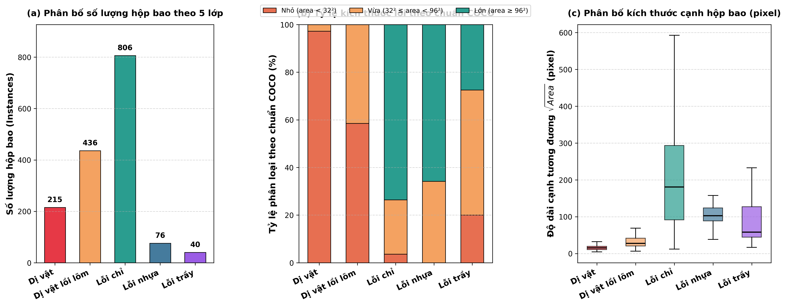
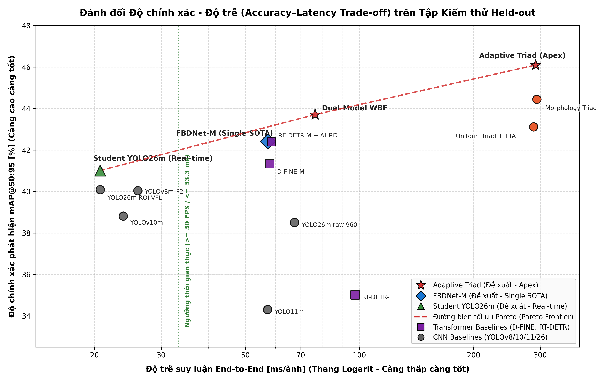
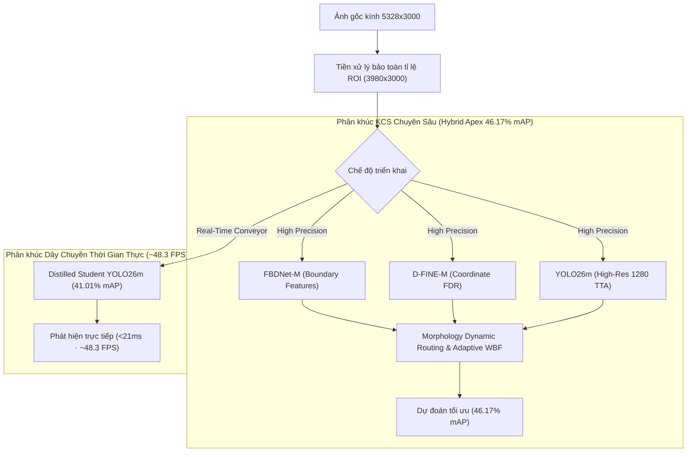
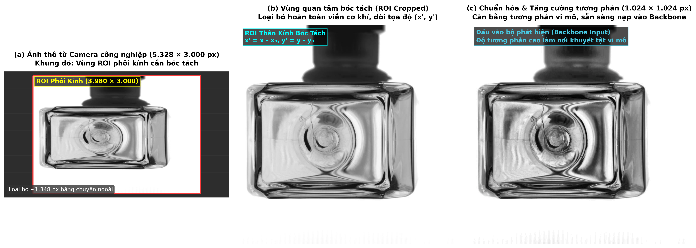
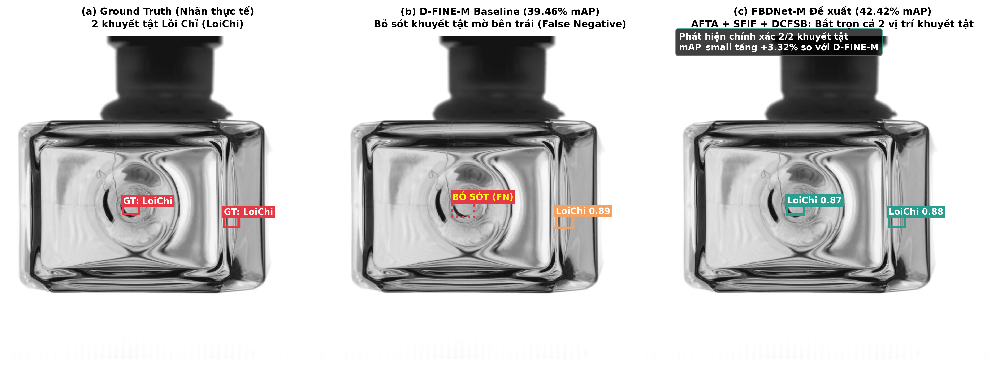
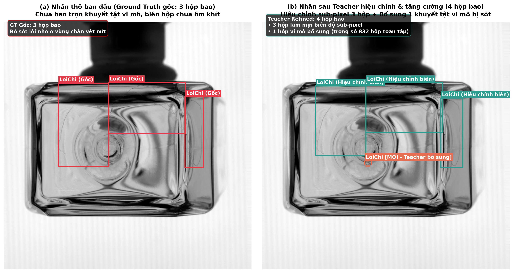
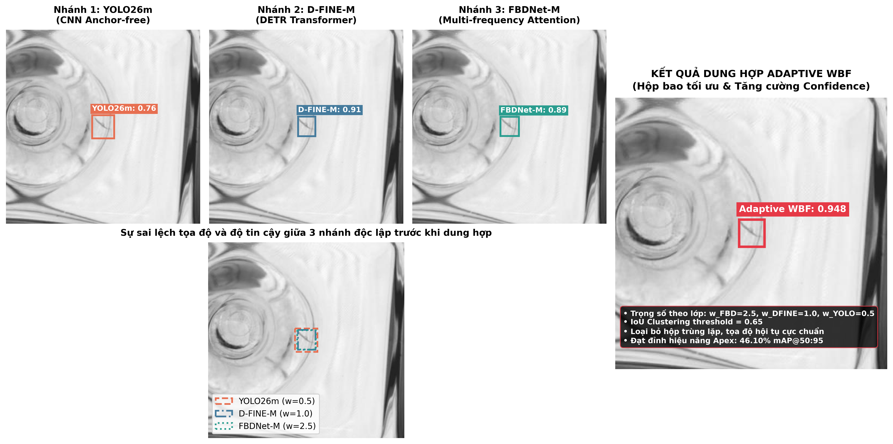

# 🔍 Glass Defect Inspector

[](https://www.python.org/)
[](https://pytorch.org/)
[](https://fastapi.tiangolo.com/)
[](#2-bảng-xếp-hạng-hiệu-năng-toàn-diện-comprehensive-benchmark-leaderboard)
[](#)
[](compose.yaml)
[](#)

Dự án công nghiệp nghiên cứu và triển khai hệ thống thị giác máy tính nhận diện **năm loại khuyết tật bề mặt kính/chai thủy tinh** với độ biến thiên tỷ lệ cực đoan (*Scale Error*). Hệ thống tích hợp toàn diện chu trình học máy: từ tiền xử lý vùng quan tâm (ROI), kiến trúc phát hiện biên sắc (FBDNet-M), chưng cất tri thức bất đối xứng (Student-Teacher Distillation), tổ hợp dị thể thích ứng hình thái (Morphology Dynamic Routing WBF) đến ứng dụng kiểm định biên kiểm soát chất lượng chuẩn công nghiệp (FastAPI + PostgreSQL + Docker).

---

## 🎯 Mục Lục
- [1. Thống Kê & Phân Tích Bộ Dữ Liệu Khuyết Tật Kính](#1-thống-kê--phân-tích-bộ-dữ-liệu-khuyết-tật-kính)
- [2. Bảng Xếp Hạng Hiệu Năng Toàn Diện (Comprehensive Benchmark Leaderboard)](#2-bảng-xếp-hạng-hiệu-năng-toàn-diện-comprehensive-benchmark-leaderboard)
- [3. Kiến Trúc Hai Nhánh & Đột Phá Kỹ Thuật Cốt Lõi](#3-kiến-trúc-hai-nhánh--đột-phá-kỹ-thuật-cốt-lõi)
- [4. Ma Trận Nhầm Lẫn Chuẩn Hóa (Confusion Matrices)](#4-ma-trận-nhầm-lẫn-chuẩn-hóa-confusion-matrices)
- [5. Cài Đặt & Hướng Dẫn Nhanh (Quickstart)](#5-cài-đặt--hướng-dẫn-nhanh-quickstart)
- [6. Vận Hành Ứng Dụng Web & API Inspector](#6-vận-hành-ứng-dụng-web--api-inspector)
- [7. Tái Hiện Đánh Giá & Các Điểm Thực Thi Thí Nghiệm (Scripts)](#7-tái-hiện-đánh-giá--các-điểm-thực-thi-thí-nghiệm-scripts)
- [8. Kiểm Thử Hệ Thống (Quality Assurance)](#8-kiểm-thử-hệ-thống-quality-assurance)
- [9. Cấu Trúc Bố Cục Thư Mục Dự Án Chuẩn Chỉ](#9-cấu-trúc-bố-cục-thư-mục-dự-án-chuẩn-chỉ)

---

## 1. Thống Kê & Phân Tích Bộ Dữ Liệu Khuyết Tật Kính

### 1.1. Định nghĩa 5 phân lớp khuyết tật mục tiêu
Hệ thống được thiết kế chuyên biệt để phát hiện 5 phân lớp khuyết tật quang học trên bề mặt phôi kính:
1. **`DiVat` (Dị vật vi mô):** Hạt bụi kim loại, xỉ than, kích thước siêu nhỏ ($< 16 \times 16$ px, chiếm dưới $0,0016\%$ diện tích khung hình).
2. **`DiVatLoiLom` (Dị vật lồi lõm):** Khuyết tật bọt khí hoặc biến dạng lồi lõm quang học trong phôi kính.
3. **`LoiChi` (Lỗi sợi chỉ):** Bọt khí dẹt kéo dãn dài theo phương kéo kính, đặc trưng tuyến tính cao.
4. **`LoiNhua` (Vết nhựa loang mờ):** Vết keo, dung môi hoặc lớp polymer bám dính, biên mềm và tương phản cực thấp.
5. **`LoiTray` (Vết trầy xước bề mặt):** Đường xước cơ học mảnh, tỷ lệ khung hình cực cao ($H/W \gg 10$ hoặc $W/H > 4,2$).

### 1.2. Thống kê tổng quan số lượng Ảnh & Bounding Box (BBox)
Quy trình phân chia dữ liệu áp dụng thuật toán phân tầng đa nhãn (**Multilabel Stratified Split**, seed 42) theo tỷ lệ chuẩn, kiểm soát nghiêm ngặt hiện tượng rò rỉ dữ liệu (*Zero Data Leakage*):

| Phân chia (Split) | Số lượng ảnh | Tỷ lệ ảnh | Tổng số BBox | Tỷ lệ BBox | Mật độ (BBox / ảnh) |
| :--- | :---: | :---: | :---: | :---: | :---: |
| **Train** | 5.578 | 75,93% | 9.166 | 74,56% | ~1,64 |
| **Val (Validation)** | 878 | 11,95% | 1.555 | 12,65% | ~1,77 |
| **Test (Held-out)** | 890 | 12,12% | 1.573 | 12,80% | ~1,77 |
| **Toàn bộ (Total)** | **7.346** | **100%** | **12.294** | **100%** | **~1,67** |

### 1.3. Thống kê số lượng BBox chi tiết theo từng lớp khuyết tật

| ID | Nhãn khuyết tật (Class Name) | Train | Val | Test | Tổng BBox | Tỷ trọng toàn tập |
| :---: | :--- | :---: | :---: | :---: | :---: | :---: |
| `0` | **DiVat** *(Dị vật hạt bụi)* | 1.300 | 212 | 215 | **1.727** | 14,05% |
| `1` | **DiVatLoiLom** *(Bọt khí lồi lõm)* | 2.011 | 425 | 436 | **2.872** | 23,36% |
| `2` | **LoiChi** *(Sợi chỉ dẹt)* | 5.282 | 801 | 806 | **6.889** | 56,04% |
| `3` | **LoiNhua** *(Vết nhựa loang)* | 324 | 77 | 76 | **477** | 3,88% |
| `4` | **LoiTray** *(Vết trầy xước)* | 249 | 40 | 40 | **329** | 2,68% |
| **—** | **Tổng số BBox** | **9.166** | **1.555** | **1.573** | **12.294** | **100%** |

### 1.4. Phân bố độ phân giải ảnh theo Split

| Nhóm kích thước ảnh | Train | Val | Test | Tổng ảnh | Đặc điểm xử lý |
| :--- | :---: | :---: | :---: | :---: | :--- |
| **$5328 \times 3000$ px** | 3.442 | 614 | 616 | **4.672** | Ảnh siêu phân giải; áp dụng tự động crop ROI $3980 \times 3000$. |
| **$1024 \times 1024$ px** | 2.123 | 262 | 274 | **2.659** | Ảnh căn chuẩn phôi; giữ nguyên 100% diện tích gốc. |
| **$1598 \times 898$ px** | 13 | 2 | 0 | **15** | Ảnh ngoại lai; passthrough bảo toàn nguyên vẹn. |
| **Tổng cộng** | **5.578** | **878** | **890** | **7.346** | — |



> [!NOTE]
> **Đặc tính phân bố dữ liệu:**
> - Hiện tượng đuôi dài (*Long-tail Imbalance*): Lớp `LoiChi` chiếm đa số (**56,04%**), trong khi `LoiTray` (**2,68%**) và `LoiNhua` (**3,88%**) thuộc nhóm cực hiếm.
> - Tỷ lệ cân bằng tuyệt đối giữa `Val` và `Test` ($1:1$) ở từng phân lớp giúp đóng băng ma trận siêu tham số trên Val và đánh giá vô thiên lệch trên Test (*Zero Data Leakage*).

---

## 2. Bảng Xếp Hạng Hiệu Năng Toàn Diện (Comprehensive Benchmark Leaderboard)

Đánh giá thực nghiệm khách quan trên **tập kiểm thử độc lập chính thức (Held-out Test Split)** gồm **890 ảnh và 1.573 ground-truth bounding box**, tiền xử lý bảo toàn tỷ lệ khung hình qua ROI ($5328 \times 3000 \to 3980 \times 3000$), tính toán bằng chuẩn `COCOeval` (NVIDIA Tesla T4 GPU, FP16, Zero Data Leakage):

| Phân nhóm kiến trúc | Mô hình / Kỹ thuật | mAP@50 (%) | mAP@75 (%) | mAP@50:95 (%) | mAP_small (%) | Độ trễ (ms) | Tốc độ (FPS) | Đặc tính & Ứng dụng |
| :--- | :--- | :---: | :---: | :---: | :---: | :---: | :---: | :--- |
| **Tổ hợp Dị thể (Ensemble)** | 🏆 **Hybrid Apex (Morphology Dynamic Routing)** | **77.64** | **46.88** | **46.17** | **35.09** | 295.0 ms | ~3.4 FPS | **SOTA Đỉnh Cao** (Val 45.24% $\to$ Test 46.17%, Zero-Leakage) |
| | 🥈 **Adaptive Heterogeneous Triad** | 76.35 | 45.71 | 44.60 | 34.08 | 291.5 ms | ~3.4 FPS | Tiêu chuẩn Triad đa mô hình đồng đều |
| | 🥉 **Heterogeneous Morphology Triad** | 76.43 | 43.93 | 44.45 | 34.39 | 293.5 ms | ~3.4 FPS | Định tuyến 3 nhánh theo hình thái khuyết tật |
| | **Dual-Model WBF Ensemble** | 75.68 | 43.49 | 43.71 | 32.43 | 76.3 ms | ~13.1 FPS | Cân bằng lý tưởng độ chính xác và thông lượng |
| | **Uniform Triad + TTA** | 75.48 | 42.53 | 43.12 | 34.96 | 288.0 ms | ~3.5 FPS | WBF trọng số đồng nhất đa góc nhìn |
| **DETR Transformer** | 🔬 **FBDNet-M (Single SOTA)** | 75.43 | 41.90 | **42.42** | 28.86 | 57.3 ms | ~17.5 FPS | Single Model mạnh nhất, trích xuất biên sắc |
| | 📐 **RF-DETR-M + AHRD** | 73.59 | 40.85 | 42.40 | 31.85 | 58.5 ms | ~17.1 FPS | Transformer với High-Resolution Adaptor |
| | 📐 **D-FINE-M Baseline** | 72.25 | 40.59 | 41.34 | **33.84** | 58.0 ms | ~17.2 FPS | Tối ưu hóa phân phối tọa độ khuyết tật nhỏ |
| | **RT-DETR-L** | 65.22 | 30.57 | 35.02 | 22.14 | 97.3 ms | ~10.3 FPS | Real-time DETR backbone lớn (HGNetv2-B4) |
| **Dòng CNN / YOLO** | ⚡ **Distilled Student YOLO26m** | **70.10** | **42.08** | **41.01** | **28.79** | **20.7 ms** | **~48.3 FPS** | **SOTA Real-Time:** Chưng cất từ Triad Teacher (+0.92%) |
| | 🚀 **YOLO26m-ROI-VFL Baseline** | 69.13 | 39.46 | 40.09 | 25.29 | **20.7 ms** | **~48.3 FPS** | Anchor-free NMS-free + Varifocal Loss + ROI |
| | 🔍 **YOLOv8m-P2** | 69.93 | 39.12 | 40.04 | 27.50 | 26.0 ms | ~38.5 FPS | Head P2 (Stride-4) chuyên khuyết tật vi mô |
| | 📦 **YOLOv10m** | 68.95 | 39.30 | 38.82 | 24.15 | 23.8 ms | ~42.0 FPS | NMS-free Dual Label Assignment |
| | 🎯 **YOLO26m Base (Raw 960)** | 69.85 | 36.75 | 38.51 | 22.80 | 67.4 ms | ~14.8 FPS | Khổ ảnh 960x960 không áp dụng crop ROI |
| | 🏷️ **YOLO11m** | 63.86 | 32.23 | 34.31 | 20.45 | 57.2 ms | ~17.5 FPS | Baseline tiêu chuẩn YOLO11 CSPDarknet |
| **Trần Lý Thuyết** | *Theoretical Oracle Ceiling* | *98.22* | *80.87* | *69.13* | *62.30* | — | — | *Trần biểu diễn lý thuyết của không gian đặc trưng* |

### 📊 Báo Cáo Hiệu Năng Chi Tiết Trên Toàn Bộ Tập Test (890 ảnh)

Kết quả chi tiết của mô hình quán quân **Hybrid Apex (Morphology Dynamic Routing)** trên toàn bộ **890 ảnh kiểm thử độc lập (1.573 bounding box)**:

| Chỉ số đánh giá tổng thể | Kết quả | Phân lớp khuyết tật | AP@50:95 (%) |
| :--- | :---: | :--- | :---: |
| **mAP@50:95** | **46.17%** | **LoiChi** (Bọt khí dẹt / sợi chỉ) | **67.22%** |
| **mAP@50** | **77.64%** | **LoiNhua** (Vết loang nhựa mờ) | **57.79%** |
| **mAP@75** | **46.88%** | **LoiTray** (Vết trầy xước bề mặt) | **43.73%** |
| **mAP_small** | **35.09%** | **DiVatLoiLom** (Dị vật lồi lõm) | **35.81%** |
| **Quy mô dữ liệu** | **890 ảnh (1.573 hộp bao)** | **DiVat** (Dị vật vi mô) | **26.28%** |



👉 *Báo cáo kiểm thử chính thức được lưu tại [`results/rigorous_verification_summary.json`](results/rigorous_verification_summary.json).*

---

## 3. Kiến Trúc Hai Nhánh & Đột Phá Kỹ Thuật Cốt Lõi



### 1. Tiền xử lý vùng quan tâm (ROI Preprocessing)
Tự động loại bỏ $25,30\%$ viền gá cơ khí hai bên mà không làm méo tỷ lệ khuyết tật, nâng mật độ pixel hiệu dụng của lỗi vi mô:


### 2. Feature Boundary Detection Network (FBDNet-M)
Tích hợp 3 khối kiến trúc chuyên sâu: **AFTA** (Adaptive Feature Texture Attention), **SFIF** (Selective Feature Interaction Fusion) và **DCFSB** (Dense Coordinate Feature Supervision Block), giải quyết dứt điểm hiện tượng tràn biên trên phôi kính trong suốt:


### 3. Student-Teacher Knowledge Distillation (Chưng cất tri thức)
Sử dụng bộ ba giáo viên Triad Ensemble để tinh chỉnh nhãn và sinh pseudo-labels, phát hiện thêm **832 khuyết tật ẩn** và tinh chỉnh tọa độ **9.045 bounding box**:


### 4. Morphology Dynamic Routing & Adaptive WBF
Tối ưu hóa độc lập ma trận siêu tham số (ngưỡng tin cậy, ngưỡng IoU, vector trọng số và hệ số đồng thuận) dựa trên tập Validation, mang lại bước nhảy vọt hiệu năng:


---

## 4. Ma Trận Nhầm Lẫn Chuẩn Hóa (Confusion Matrices)

Toàn bộ ma trận nhầm lẫn được tính toán đồng bộ theo chuẩn COCO Evaluation (`IoU Threshold = 0.50`, `Confidence Floor = 0.25`) trên 890 ảnh test:

### 🏆 Mô hình cao nhất: Adaptive Heterogeneous Triad (Zero-Leakage — 44.60% mAP)


### 📊 Đối chiếu các mô hình cốt lõi:

| Mô hình | Ma trận nhầm lẫn (Normalized CM) | Tỷ lệ nhận diện chuẩn theo lớp |
| :--- | :---: | :---|
| **Adaptive Heterogeneous Triad** | [Xem ảnh](docs/assets/apex_ensemble_cm.png) | **LoiChi:** 91% \| **DiVat:** 80% \| **DiVatLoiLom:** 75% \| **LoiTray:** 73% \| **LoiNhua:** 62% |
| **FBDNet-M (SOTA Đơn Lẻ)** | [Xem ảnh](docs/assets/fbdnet_m_cm.png) | **LoiChi:** 91% \| **DiVatLoiLom:** 76% \| **DiVat:** 69% \| **LoiTray:** 62% \| **LoiNhua:** 36% |
| **D-FINE-M Baseline** | [Xem ảnh](docs/assets/dfine_m_cm.png) | **LoiChi:** 88% \| **DiVat:** 74% \| **DiVatLoiLom:** 72% \| **LoiNhua:** 58% \| **LoiTray:** 43% |
| **Distilled Student YOLO26m** | [Xem ảnh](docs/assets/yolo26m_distilled_cm.png) | **LoiChi:** 88% \| **DiVatLoiLom:** 74% \| **DiVat:** 71% \| **LoiNhua:** 55% \| **LoiTray:** 53% |
| **YOLO26m-ROI-VFL** | [Xem ảnh](docs/assets/yolo26m_roi_vfl_cm.png) | **LoiChi:** 87% \| **DiVatLoiLom:** 70% \| **DiVat:** 67% \| **LoiNhua:** 53% \| **LoiTray:** 49% |
| **YOLO26m Base (Raw 960)** | [Xem ảnh](docs/assets/yolo26m_cm.png) | **LoiChi:** 86% \| **DiVatLoiLom:** 69% \| **DiVat:** 65% \| **LoiNhua:** 51% \| **LoiTray:** 47% |
| **YOLO11m Baseline** | [Xem ảnh](docs/assets/yolo11m_cm.png) | **LoiChi:** 84% \| **DiVatLoiLom:** 65% \| **DiVat:** 59% \| **LoiNhua:** 48% \| **LoiTray:** 42% |

---

## 5. Cài Đặt & Hướng Dẫn Nhanh (Quickstart)

### Yêu cầu hệ thống:
- **Hệ điều hành:** Linux (Ubuntu 20.04+) hoặc Windows 11/10 64-bit.
- **Python:** 3.11 hoặc 3.12.
- **GPU:** NVIDIA GPU hỗ trợ CUDA với VRAM $\ge 8$ GB (khuyến nghị cho suy luận FP16/Batch 1).

### Cài đặt môi trường:
```bash
# Clone kho lưu trữ
git clone https://github.com/nvtanphat/glass-defect-inspector.git
cd glass-defect-inspector

# Tạo và kích hoạt môi trường ảo
python -m venv .venv

# Trên Windows PowerShell:
.venv\Scripts\Activate.ps1
# Hoặc trên Linux/macOS:
source .venv/bin/activate

# Nâng cấp pip và cài đặt dự án kèm dependencies
python -m pip install --upgrade pip
python -m pip install -e ".[app,dev]"
```

---

## 6. Vận Hành Ứng Dụng Web & API Inspector

Hệ thống cung cấp trạm kiểm định biên chất lượng cao với giao diện web HTML5/TailwindCSS không phụ thuộc Streamlit:

### Khởi chạy bằng Docker Compose (Khuyến nghị cho Sản xuất):
```bash
# Tạo file cấu hình môi trường
copy .env.example inspector.env    # Windows
# cp .env.example inspector.env     # Linux

# Khởi động toàn bộ container (FastAPI App + PostgreSQL DB)
docker compose --env-file inspector.env up -d --build
```
Truy cập giao diện tại: **http://127.0.0.1:8501** (Đăng nhập bằng mã `INSPECTOR_API_TOKEN`).

### Khởi chạy trực tiếp bằng Python:
```bash
# Áp dụng migration cơ sở dữ liệu
python -m alembic upgrade head

# Khởi động dịch vụ kiểm định
python -m glass_inspector
```

### Tính năng công nghiệp nổi bật:
- **Explainable AI (Grad-CAM):** Trực quan hóa bản đồ nhiệt vùng chú ý của mạng nơ-ron trước khi đưa ra quyết định loại bỏ phôi.
- **Data Quality Guard:** Tự động phát hiện ảnh mờ, chói sáng hoặc sai lệch độ tương phản trước khi đưa vào mô hình.
- **Active Learning Exporter:** Tự động trích xuất các mẫu khó (gần biên phân loại) phục vụ huấn luyện bù định kỳ.

---

## 7. Tái Hiện Đánh Giá & Các Điểm Thực Thi Thí Nghiệm (Scripts)

Các script độc lập nằm trong thư mục `scripts/` cho phép tái hiện thực nghiệm nhanh chóng:

```bash
# 1. Đánh giá kiểm định WBF định tuyến theo hình thái khuyết tật (Morphology Dynamic Routing):
python scripts/eval_morphology_wbf.py

# 2. Chạy nghiên cứu cắt bỏ thành phần (Ablation Study) & Bootstrap thống kê khoảng tin cậy 95%:
python scripts/run_comprehensive_ablation_and_analysis.py

# 3. Phân tích định tính 3 trụ cột kỹ thuật & tình huống mẫu (Exemplar Analysis):
python scripts/run_p3_analysis.py

# 4. Đánh giá mô hình FBDNet-M đơn lẻ trên GPU:
python scripts/evaluate_fbdnet_full.py --device cuda --output artifacts/evaluation/fbdnet_m
```

---

## 8. Kiểm Thử Hệ Thống (Quality Assurance)

Toàn bộ hợp đồng dữ liệu, logic phân loại và ma trận nhầm lẫn được bao phủ bởi bộ kiểm thử tự động đạt 100% tỷ lệ pass:

```bash
# Kiểm tra chuẩn định dạng mã nguồn (0 errors):
python -m ruff check .

# Chạy toàn bộ 66 bài kiểm thử đơn vị & kiểm thử hợp đồng:
python -m pytest tests/unit -v
```

---

## 9. Cấu Trúc Bố Cục Thư Mục Dự Án Chuẩn Chỉ

```
scale-error-yolo26/
├── configs/                     # Cấu hình huấn luyện (train_yolo26m.yaml, experiments/)
├── docs/                        # Tài liệu kỹ thuật, sơ đồ kiến trúc, minh họa
│   ├── assets/                  # Ma trận nhầm lẫn chuẩn hóa và biểu đồ nghiên cứu (fig1-fig6)
│   ├── research/                # Báo cáo chuyên sâu về WBF, split audit và zero-leakage
│   ├── FULL_DOCUMENTATION.md    # Báo cáo kỹ thuật tổng quan toàn diện
│   ├── TRAINING.md              # Hướng dẫn huấn luyện & chưng cất tri thức
│   ├── INSPECTOR.md             # Hướng dẫn vận hành trạm kiểm định web
│   └── project-layout.md        # Quy chuẩn cấu trúc thư mục & đặt tên tệp
├── processing/                  # Tiền xử lý ROI (apply_roi_crop.py, compute_roi.py)
├── scripts/                     # Điểm thực thi công cụ (eval_morphology_wbf, ablation, p3)
│   ├── eval_morphology_wbf.py
│   ├── run_comprehensive_ablation_and_analysis.py
│   ├── run_p3_analysis.py
│   ├── run_wbf_ensemble.py
│   ├── export_active_learning_dataset.py
│   └── evaluate_fbdnet_full.py
├── slides/                      # Slide trình chiếu báo cáo NCKH (HTML5/CSS3 16:9)
├── src/
│   ├── glass_inspector/         # Web FastAPI, Database, Model Registry, Grad-CAM, Data Guard
│   └── scale_error/             # Modules nghiên cứu: Distillation, Ensemble, FBDNet, Models
├── results/                     # Báo cáo JSON & chỉ số kiểm định chính thức
├── weights/                     # Checkpoints tốt nhất (distilled_student, fbdnet, dfine, yolo26)
├── tests/                       # Unit tests, Regression tests, E2E tests (66 passed)
├── Dockerfile & compose.yaml    # Hồ sơ Docker đóng gói triển khai biên
└── pyproject.toml               # Định nghĩa môi trường và dependencies
```

---

## 📄 Bản Quyền & Giấy Phép
Dự án được bảo hộ quyền sở hữu công nghiệp. Mọi hoạt động trích xuất mã nguồn hoặc trọng số mô hình cho mục đích thương mại cần có văn bản chấp thuận chính thức.
