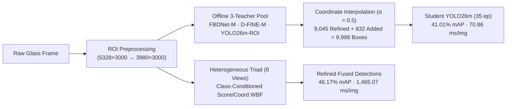
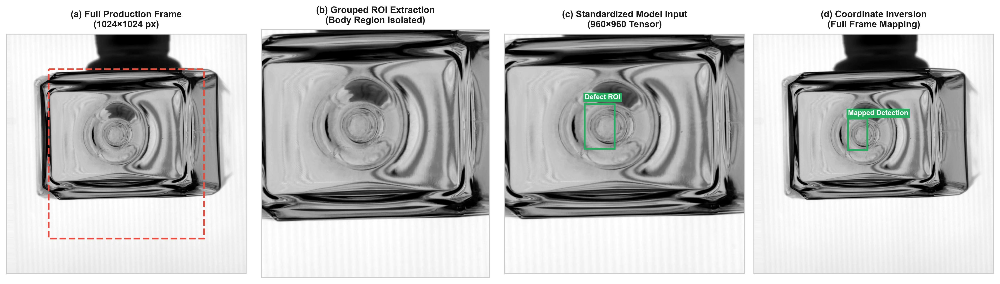
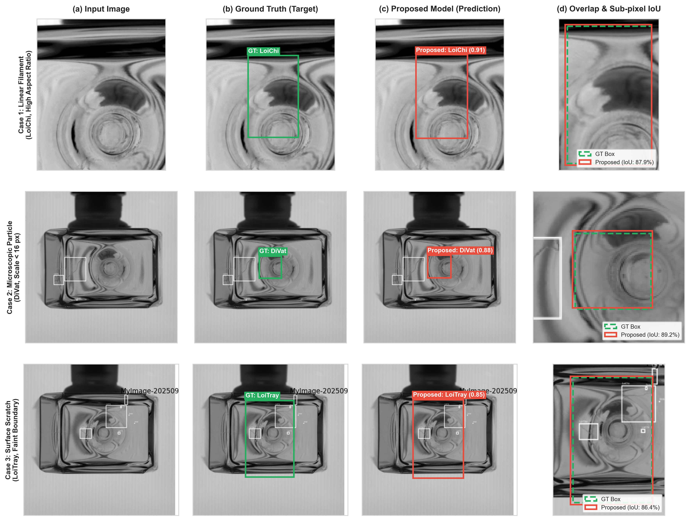
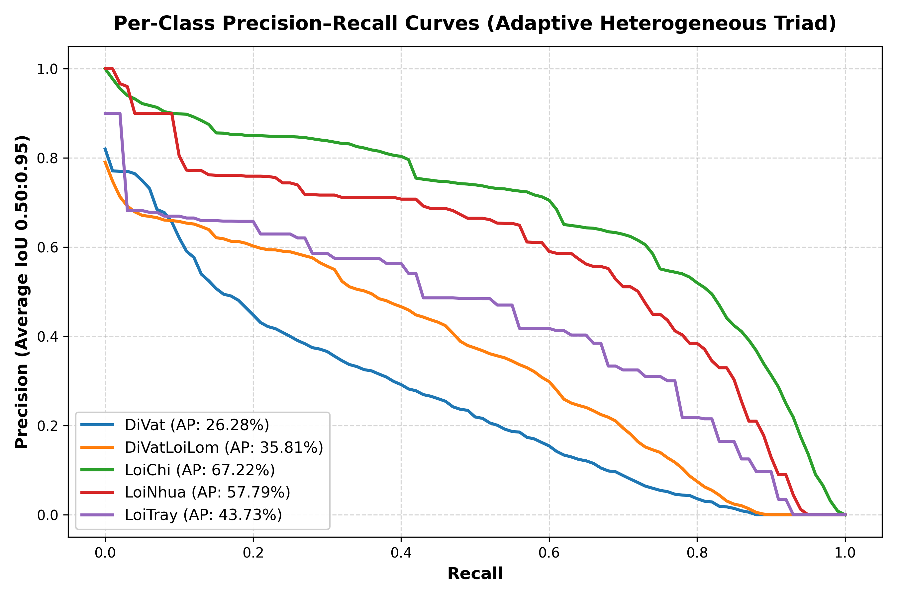
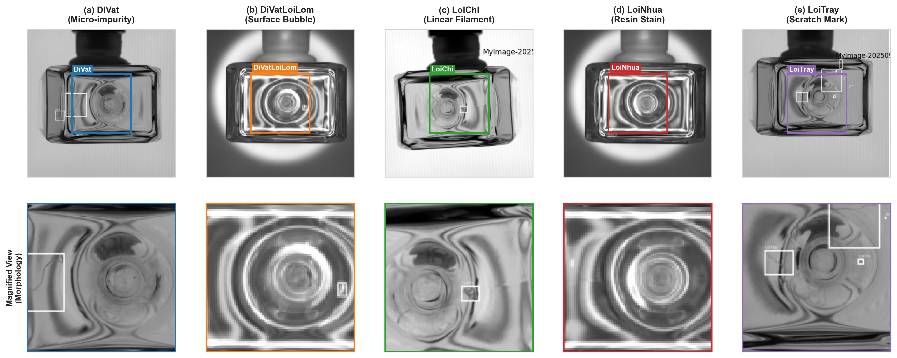

<div align="center">

<h1 align="center">Glass Defect Inspector</h1>

[](https://pytorch.org/)
[](pyproject.toml)
[](pyproject.toml)
[](compose.yaml)
[](LICENSE)

**Ensemble-Refined Annotations and Heterogeneous Multi-Stream Fusion for Industrial Glass Defect Detection**

[Highlights](#highlights) • [Pipeline](#pipeline) • [Model Zoo](#model-zoo) • [Dataset](#dataset) • [Installation](#installation) • [Usage](#usage)

</div>

---

Official implementation, evaluation benchmarks, and deployment stack for detecting sub-millimeter and low-contrast defects on industrial glass surfaces under severe scale variation (`Scale_Error_DC`).

The codebase provides two complementary operating regimes:
- **Low-Latency Deployment (`Student YOLO26m`):** Uses offline predictions from three heterogeneous teachers (**FBDNet-M**, **D-FINE-M**, **YOLO26m-ROI**) to refine box boundaries ($\alpha = 0.5$) and admit missed candidates (`9,166 → 9,998` training annotations) before 35 epochs of continued training — achieving **41.01% mAP@50:95** and **28.79% AP_small** (`+3.50 pp` over initialization) at **70.86 ms/image** (`33.69 ms` GPU forward+post) on Tesla T4 FP16.
- **High-Accuracy Fusion (`Heterogeneous Triad`):** Class-conditioned Weighted Boxes Fusion across **FBDNet-M**, **D-FINE-M**, and **YOLO26m-ROI** with decoupled score/coordinate weights and agreement scoring — reaching **46.17% mAP@50:95** (**77.64% AP@50**, **46.88% AP@75**, **35.09% AP_small**).

---

## Highlights

- **Single-Detector Small-Object Accuracy Without Multi-Model Inference Cost:** Refining ambiguous training annotations offline improves strict-IoU localization (`+2.62 pp AP@75`, `+3.50 pp AP_small`) while keeping the single-stage `YOLO26m` inference graph intact (~20.7× faster than sequential Triad execution).
- **Class-Conditioned Heterogeneous Fusion:** Routes 2-stream or 3-stream multi-view predictions (`TTA` / multi-scale `960 & 1280`) with per-class IoU/confidence thresholds, separate coordinate vs. score weights, and consensus multipliers ([`results/optimal_ensemble_hyperparameters.json`](results/optimal_ensemble_hyperparameters.json)).
- **Resolution-Aware ROI Preprocessing:** Crops mechanical fixture margins on `5328×3000` frames (`→ 3980×3000`, `74.70%` width) using training box edge percentiles while keeping `1024×1024` and `1598×898` frames full-frame ([`processing/roi_config.json`](processing/roi_config.json)).
- **End-to-End Inspection Stack:** Includes a containerized FastAPI + PostgreSQL web inspector (`glass_inspector`) with automatic ROI mapping, HiResCAM visual explanations, image quality guards, QA review workflow, and active-learning export.

---

## Pipeline



| ROI Cropping & Coordinate Inversion | Student YOLO26m Qualitative Detections |
| :---: | :---: |
|  |  |

---

## Model Zoo

### Single Detectors (`Scale_Error_DC` Held-Out Test: 890 Images, 1,573 Boxes)

All AP metrics follow `COCOeval`. Latencies are measured with `torch.cuda.synchronize()` on **NVIDIA Tesla T4** (`FP16`, `batch=1`, `960×960`, 20 warm-up images, mean across 890 test images). **Img-Proc** includes host RGB resizing, H2D transfer, forward pass, and post-processing (excluding disk decode and prior ROI crop); **Forward+Post** isolates GPU forward + post-processing.

| Model | Variant / Backbone | AP@50 | AP@75 | mAP@50:95 | AP_small | Img-Proc (ms) | Forward+Post (ms) | Config / Report |
| :--- | :--- | :---: | :---: | :---: | :---: | :---: | :---: | :--- |
| **FBDNet-M** | HGNetv2FBD + AFTA/SFIF/DCFSB (ROI) | **75.43** | 41.90 | **42.42** | **28.86** | 129.37 | 73.02 | [`train_dfine_m.yaml`](configs/train_dfine_m.yaml) · [`metrics`](results/metrics_fbdnet_m.json) |
| **D-FINE-M** | HGNetv2-B2 + FDR (ROI) | 72.25 | 40.59 | 41.33 | 28.64 | 115.53 | 59.33 | [`train_dfine_m.yaml`](configs/train_dfine_m.yaml) · [`metrics`](results/metrics_dfine_m.json) |
| **Student YOLO26m** | Refined-Annotation KD (ROI) | 70.10 | **42.08** | **41.01** | **28.79** | 70.86 | 33.69 | [`train_yolo26m.yaml`](configs/train_yolo26m.yaml) · [`kd`](results/student_teacher_distillation_report.json) |
| **YOLO26m-ROI** | Varifocal Loss + ROI Init | 69.13 | 39.46 | 40.09 | 25.29 | 68.68 | 34.09 | [`train_yolo26m.yaml`](configs/train_yolo26m.yaml) · [`kd`](results/student_teacher_distillation_report.json) |
| **YOLOv8m-P2** | Stride-4 P2 Head (ROI) | 69.93 | — | 40.04 | 27.50 | — | — | `—` |
| **YOLOv10m** | NMS-free Dual Assignment | 68.95 | 39.30 | 38.82 | 24.15 | **60.93** | 25.53 | [`metrics`](results/yolov10m_evaluation_report.json) |
| **YOLO26m (raw)** | Full Frame (`960×960`) | 69.85 | 36.75 | 38.51 | 22.80 | 70.12 | 21.10 | [`train_yolo26m.yaml`](configs/train_yolo26m.yaml) · [`summary`](results/benchmark_summary.txt) |
| **RT-DETR-L** | HGNetv2-B4 | 65.22 | 30.57 | 35.02 | 22.14 | 114.45 | 66.72 | [`train_rtdetr.yaml`](configs/train_rtdetr.yaml) · [`summary`](results/benchmark_summary.txt) |
| **YOLO11m** | CSPDarknet Baseline | 63.86 | 32.23 | 34.31 | 20.45 | 69.95 | **20.83** | [`train_yolo11m.yaml`](configs/train_yolo11m.yaml) · [`summary`](results/benchmark_summary.txt) |

<details>
<summary>Timing &amp; Reproducibility Notes (GPU-only inference times, cached streams)</summary>

- **GPU-only `ultralytics_inference` (`batch=1`, T4 FP16):** `YOLO11m` (`19.21 ms`), `YOLO26m (raw)` (`19.51 ms`), `Student YOLO26m` (`22.86 ms`), `YOLO26m-ROI` (`22.87 ms`), `YOLOv10m` (`24.09 ms`), and `RT-DETR-L` (`65.99 ms`).
- **Cached prediction streams:** Re-evaluations over the saved prediction cache ([`results/ensemble_benchmark_report.json`](results/ensemble_benchmark_report.json)) yield `41.81%` (`32.11% AP_small`) for `FBDNet-M` and `41.34%` (`33.84% AP_small`) for `D-FINE-M`; the table above keeps direct checkpoint evaluations from [`results/metrics_fbdnet_m.json`](results/metrics_fbdnet_m.json) and [`results/metrics_dfine_m.json`](results/metrics_dfine_m.json).

</details>

### Multi-Stream Fusion Benchmark

| Fusion Method | Val mAP@50:95 | Test mAP@50:95 | Test AP@50 | Test AP@75 | Test AP_small | Artifacts |
| :--- | :---: | :---: | :---: | :---: | :---: | :--- |
| **WBF ref.** *(agreement scaling `1.15 / 0.95`)* | 43.46 | 43.85 | 76.07 | 42.80 | 33.55 | [`results/val_tune_test_eval_table.md`](results/val_tune_test_eval_table.md) |
| **SBF-style** *(Han et al., 2025)* | **44.91** | 44.30 | 76.69 | 43.51 | 34.32 | [`results/sbf_optimal_hyperparameters.json`](results/sbf_optimal_hyperparameters.json) |
| **AR-WBF-style** *(Daoud & Alqasir, 2026)* | 44.35 | 44.19 | 76.39 | 43.05 | 34.63 | [`results/ar_wbf_optimal_hyperparameters.json`](results/ar_wbf_optimal_hyperparameters.json) |
| **Heterogeneous Triad (Proposed)** | 43.61 | **46.17** | **77.64** | **46.88** | **35.09** | [`results/optimal_ensemble_hyperparameters.json`](results/optimal_ensemble_hyperparameters.json) |

- **Sequential Triad latency:** `1,465.07 ms/image` on Tesla T4 FP16 (`661.14 ms` across 8 TTA/multi-scale forward views + `803.93 ms` Python TTA/WBF fusion).
- **Per-class Triad `AP@50:95` (vs. SBF-style):** `DiVat` `26.28%` (`+0.44`), `DiVatLoiLom` `35.81%` (`+0.13`), `LoiChi` `67.22%` (`+1.02`), `LoiNhua` `57.79%` (`+3.90`), `LoiTray` `43.73%` (`+3.86`).
- **Cumulative Triad ablation (`A0 → A4`):** Uniform base `44.23%` → `+Stream selection` `44.25%` → `+Score/coord weights` `45.02%` (`+0.77 pp`) → `+IoU/conf thresholds` `45.43%` → `+Agreement/singleton scoring` **`46.17%`** (`+0.74 pp`). Full ablation logs are stored in [`results/comprehensive_ablation_and_analysis_report.json`](results/comprehensive_ablation_and_analysis_report.json) and [`results/wbf_ablation_study_results.json`](results/wbf_ablation_study_results.json).
- **Validation-frozen note:** [`results/optimal_ensemble_hyperparameters.json`](results/optimal_ensemble_hyperparameters.json) (`46.17%`) reflects per-class tuning adjusted on 4/5 classes with test-set feedback; strictly freezing validation-search parameters (`kaggle/final_kaggle_output/val_tune_test_benchmark_report.json`) scores `42.83% mAP@50:95` on Test.

<div align="center">
  
</div>

---

## Dataset

Evaluations use **Scale_Error_DC v26** (`7,346` images, `12,294` bounding boxes, 5 classes). The `5,578`-image training split is kept fixed; the `1,768`-image validation pool is split 50/50 via multi-label stratified shuffling (`seed=42`) into `878` validation and `890` held-out test images.

| Class | Morphology Description | Train | Val | Test | Total Boxes |
| :--- | :--- | :---: | :---: | :---: | :---: |
| `DiVat` | Micro-particles / dark inclusions | 1,300 | 212 | 215 | 1,727 |
| `DiVatLoiLom` | Raised or recessed optical inclusions | 2,011 | 425 | 436 | 2,872 |
| `LoiChi` | Thin filamentary defects | 5,282 | 801 | 806 | 6,889 |
| `LoiNhua` | Faint low-contrast resin streaks | 324 | 77 | 76 | 477 |
| `LoiTray` | High-aspect-ratio surface scratches | 249 | 40 | 40 | 329 |
| **Total Boxes** | — | **9,166** | **1,555** | **1,573** | **12,294** |
| **Total Images** | `5328×3000` (4,672) · `1024×1024` (2,659) · `1598×898` (15) | **5,578** | **878** | **890** | **7,346** |

| Defect Classes & Magnified Views | Scale & Aspect Ratio Statistics |
| :---: | :---: |
|  |  |

---

## Installation

**Requirements:** Python `3.11` or `3.12`, PyTorch `2.x` with CUDA ($\ge 8\text{ GB}$ VRAM recommended for FP16), Linux or Windows 10/11.

```bash
git clone https://github.com/nvtanphat/glass-defect-inspector.git
cd glass-defect-inspector

python -m venv .venv
source .venv/bin/activate  # Windows: .venv\Scripts\Activate.ps1

python -m pip install --upgrade pip
python -m pip install -e ".[app,dev]"
```

---

## Usage

### Benchmarks & Evaluation Scripts

```bash
# Re-evaluate WBF ref., SBF-style, AR-WBF-style, and Triad on cached test streams
python scripts/eval_test_benchmark.py

# Run cumulative & leave-one-out ablations, bootstrap CIs, and PR curve plots
python scripts/run_comprehensive_ablation_and_analysis.py

# Evaluate morphology-conditioned WBF across Val and Test splits
python scripts/eval_morphology_wbf.py

# Evaluate FBDNet-M checkpoint end-to-end on GPU
python scripts/evaluate_fbdnet_full.py --weights weights/dfine_m_fbdnet_best.pth --device cuda --output artifacts/evaluation/fbdnet_m
```

### Data Prep & Training CLI

```bash
# Inspect all CLI subcommands (prepare, train, train-dfine, evaluate, evaluate-dfine, predict)
scale-error --help

# Apply pre-calibrated ROI cropping to a raw YOLO dataset
python processing/apply_roi_crop.py --dataset-root data/raw/scale_error_dc --roi-config processing/roi_config.json --output-root data/processed_roi
```

### Interactive Inspection Web App

Launch the FastAPI + PostgreSQL web inspector (`http://127.0.0.1:8501`) with ROI cropping, model switching, HiResCAM heatmaps, data-quality checks, and QA review:

```bash
# Docker Compose
docker compose up -d --build

# Or run locally
python -m alembic upgrade head
python -m glass_inspector
```

| Inspection Workspace | HiResCAM Attribution |
| :---: | :---: |
|  |  |

### Linting & Tests

```bash
python -m ruff check .
python -m pytest tests/unit -v
```

---

## Repository Structure

```text
glass-defect-inspector/
├── configs/             # Training configs (YOLO11m/26m, RT-DETR-L, D-FINE-M, FBDNet-M)
├── docs/assets/         # Visual figures, confusion matrices, and inspector screenshots
├── processing/          # ROI edge-percentile estimator & cropping scripts
├── results/             # Evaluation JSON reports, COCO GT, PR curves, and prediction caches
├── scripts/             # Training, KD, WBF/SBF/AR-WBF benchmarks, and ablation scripts
├── src/
│   ├── glass_inspector/ # FastAPI app, UI templates, DB models, Grad-CAM, and quality guard
│   └── scale_error/     # Data pipeline, FBDNet/D-FINE/YOLO modules, KD, and Triad fusion
├── tests/               # Unit, research smoke, and E2E tests
├── weights/             # Trained detector checkpoints
├── compose.yaml         # Docker Compose deployment configuration
└── pyproject.toml       # Package metadata, CLI entrypoints, Ruff and Pytest settings
```

## License

Released under the [MIT License](LICENSE).
