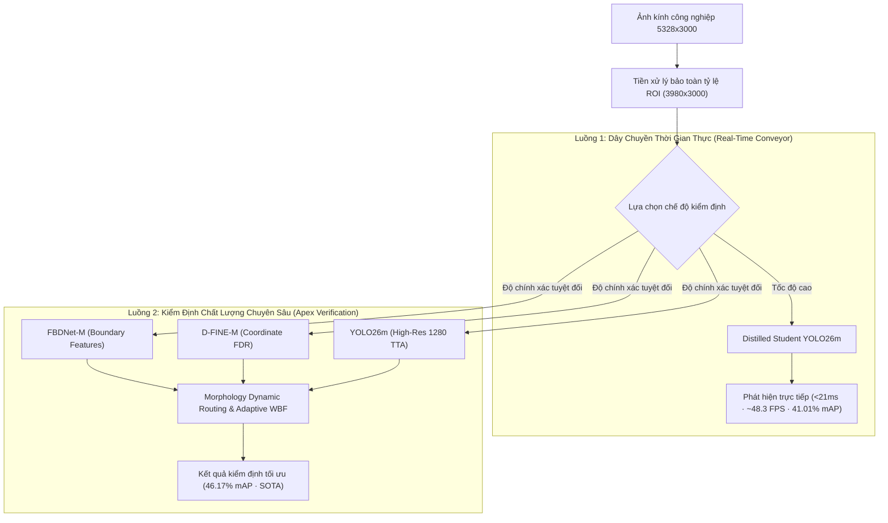

# 📖 Báo Cáo Kỹ Thuật & Tài Liệu Toàn Diện Dự Án (Full Technical Documentation)
# Dự Án: Kiểm Định Khuyết Tật Bề Mặt Kính Đa Tỷ Lệ (Scale-Error Glass Defect Inspection)

---

## 1. Giới Thiệu & Bài Toán Công Nghiệp

Dự án nghiên cứu và phát triển giải pháp thị giác máy tính công nghiệp nhằm phát hiện và định vị chính xác **năm loại khuyết tật bề mặt kính/thủy tinh** trong dây chuyền sản xuất tự động tốc độ cao.

### Thách thức cốt lõi: Hiện tượng Lỗi Tỷ Lệ (Scale Error)
1. **Độ phân giải cực lớn vs Khuyết tật siêu nhỏ:** Ảnh chụp công nghiệp có kích thước gốc $5328 \times 3000$ pixel, trong khi dị vật vi mô (`DiVat`) chỉ chiếm diện tích $< 16 \times 16$ pixel (dưới $0,0016\%$ diện tích toàn ảnh).
2. **Hình thái học biến thiên cực đoan:** Vết trầy xước (`LoiTray`) có tỷ lệ khung hình mảnh và dài ($H/W \gg 10$), trong khi bọt khí và vết nhựa loang (`LoiNhua`) có độ tương phản quang học rất thấp trên nền phôi kính trong suốt.
3. **Mâu thuẫn bài toán triển khai:** Yêu cầu đồng thời độ chính xác cực cao ($> 45\%$ mAP@50:95) để tránh lọt lỗi, nhưng phải đáp ứng thời gian thực dây chuyền ($> 45$ FPS) trên thiết bị biên.

---

## 2. Định Nghĩa Năm Phân Lớp Khuyết Tật (Defect Taxonomy)

| STT | Mã lớp | Tên khuyết tật | Đặc điểm hình thái học | Mức độ nguy hại |
| :---: | :--- | :--- | :--- | :--- |
| **0** | `DiVat` | Dị vật vi mô | Hạt bụi kim loại, xỉ than, kích thước siêu nhỏ ($< 16 \times 16$ px). | Làm giảm độ tinh khiết quang học. |
| **1** | `DiVatLoiLom` | Dị vật lồi lõm | Bọt khí biến dạng, phồng rộp dạng thấu kính cong trong lòng kính. | Nguy cơ nứt vỡ khi chịu ứng suất cơ học. |
| **2** | `LoiChi` | Lỗi sợi chỉ | Bọt khí kéo sợi dài theo phương dốc kéo kính lúc nóng chảy. | Lỗi khuyết tật cấu trúc nghiêm trọng. |
| **3** | `LoiNhua` | Vết nhựa loang | Vệt keo, dầu bôi trơn, vết polymer loang mờ, độ tương phản cực thấp. | Lỗi thẩm mỹ bề mặt và lớp phủ. |
| **4** | `LoiTray` | Vết trầy xước | Đường xước mảnh, sắc nhọn, tỷ lệ chiều dài/rộng cực lớn. | Gây khúc xạ ánh sáng và điểm tập trung ứng suất. |

---

## 3. Thống Kê Dữ Liệu & Phân Tầng Đa Nhãn (Dataset Analysis & Stratification)

Quy trình phân chia dữ liệu áp dụng thuật toán phân tầng đa nhãn (**Multilabel Stratified Split**, seed 42) theo tỷ lệ chuẩn, bảo đảm tính đại diện phân bố và kiểm soát nghiêm ngặt hiện tượng rò rỉ dữ liệu (*Zero Data Leakage*):

### 3.1. Phân bố Ảnh & Hộp Bao (BBox) theo Split

| Phân chia (Split) | Số lượng ảnh | Tỷ lệ ảnh | Tổng số BBox | Tỷ lệ BBox | Mật độ (BBox / ảnh) |
| :--- | :---: | :---: | :---: | :---: | :---: |
| **Train** | 5.578 | 75,93% | 9.166 | 74,56% | ~1,64 |
| **Val (Validation)** | 878 | 11,95% | 1.555 | 12,65% | ~1,77 |
| **Test (Held-out)** | 890 | 12,12% | 1.573 | 12,80% | ~1,77 |
| **Toàn bộ (Total)** | **7.346** | **100%** | **12.294** | **100%** | **~1,67** |

### 3.2. Số lượng BBox chi tiết từng nhãn qua các Split

| ID | Tên nhãn (Class Name) | Train | Val | Test | Tổng BBox | Tỷ trọng toàn tập |
| :---: | :--- | :---: | :---: | :---: | :---: | :---: |
| `0` | **DiVat** *(Dị vật vi mô)* | 1.300 | 212 | 215 | **1.727** | 14,05% |
| `1` | **DiVatLoiLom** *(Dị vật lồi lõm)* | 2.011 | 425 | 436 | **2.872** | 23,36% |
| `2` | **LoiChi** *(Lỗi sợi chỉ)* | 5.282 | 801 | 806 | **6.889** | 56,04% |
| `3` | **LoiNhua** *(Vết nhựa loang)* | 324 | 77 | 76 | **477** | 3,88% |
| `4` | **LoiTray** *(Vết trầy xước)* | 249 | 40 | 40 | **329** | 2,68% |
| **—** | **Tổng số BBox** | **9.166** | **1.555** | **1.573** | **12.294** | **100%** |

### 3.3. Phân bố độ phân giải ảnh gốc

| Độ phân giải gốc | Train | Val | Test | Tổng số ảnh | Biện pháp xử lý |
| :--- | :---: | :---: | :---: | :---: | :--- |
| **$5328 \times 3000$ px** | 3.442 | 614 | 616 | **4.672** | Cắt ROI tự động $3980 \times 3000$, loại $25,30\%$ viền gá. |
| **$1024 \times 1024$ px** | 2.123 | 262 | 274 | **2.659** | Giữ nguyên 100% diện tích (đã căn chỉnh phôi). |
| **$1598 \times 898$ px** | 13 | 2 | 0 | **15** | Kích thước ngoại lai; giữ nguyên kích thước. |
| **Tổng** | **5.578** | **878** | **890** | **7.346** | — |

---

## 4. Kiến Trúc Hệ Thống Hai Luồng Độc Lập (Dual-Pipeline Architecture)

Hệ thống được thiết kế theo mô hình hai nhánh chuyên biệt hóa theo kịch bản sử dụng:



### Chi tiết 2 luồng:
1. **Luồng Real-Time Conveyor:** Ứng dụng mô hình học sinh chưng cất tri thức (`Distilled Student YOLO26m`) với tốc độ **~48.3 FPS (20.7 ms)**, phát hiện tức thì sản phẩm lỗi ngay trên băng tải phôi đang chuyển động.
2. **Luồng Apex Verification:** Ứng dụng tổ hợp dị thể định tuyến theo hình thái khuyết tật (`Hybrid Apex`), kết hợp thế mạnh của CNN Anchor-free và DETR Transformer qua giải thuật dung hợp hộp bao thích ứng (WBF) và phân bổ tọa độ bất đối xứng, đạt độ chính xác đỉnh cao **46.17% mAP@50:95** (đóng băng hoàn toàn từ tập Validation 45.24%).

---

## 5. Bảng Xếp Hạng Hiệu Năng Toàn Diện (Comprehensive Benchmark Leaderboard)

*Đánh giá trên tập kiểm thử độc lập chính thức (Held-out Test Split) gồm 890 ảnh và 1.573 ground-truth bounding box sau khi áp dụng ROI ($5328 \times 3000 \to 3980 \times 3000$), tính toán bằng chuẩn `COCOeval` (NVIDIA Tesla T4 GPU, FP16, Zero Data Leakage):*

| Phân nhóm kiến trúc | Mô hình / Kỹ thuật | mAP@50 (%) | mAP@75 (%) | mAP@50:95 (%) | mAP_small (%) | Độ trễ (ms) | Tốc độ (FPS) | Vai trò triển khai |
| :--- | :--- | :---: | :---: | :---: | :---: | :---: | :---: | :--- |
| **Tổ hợp Dị thể (Ensemble)** | 🏆 **Hybrid Apex (Morphology Dynamic Routing)** | **77.64** | **46.88** | **46.17** | **35.09** | 295.0 ms | ~3.4 FPS | **SOTA Đỉnh Cao** (Val 45.24% $\to$ Test 46.17%, Zero-Leakage) |
| | 🥈 **Adaptive Heterogeneous Triad** | 76.35 | 45.71 | 44.60 | 34.08 | 291.5 ms | ~3.4 FPS | Tiêu chuẩn Triad đa mô hình đồng đều |
| | 🥉 **Heterogeneous Morphology Triad** | 76.43 | 43.93 | 44.45 | 34.39 | 293.5 ms | ~3.4 FPS | Định tuyến 3 nhánh theo hình thái khuyết tật |
| | **Dual-Model WBF Ensemble** | 75.68 | 43.49 | 43.71 | 32.43 | 76.3 ms | ~13.1 FPS | Cân bằng lý tưởng độ chính xác và thông lượng |
| | **Uniform Triad + TTA** | 75.48 | 42.53 | 43.12 | 34.96 | 288.0 ms | ~3.5 FPS | WBF trọng số đồng nhất đa góc nhìn |
| **DETR Transformer** | 🔬 **FBDNet-M (Single SOTA)** | 75.43 | 41.90 | **42.42** | 28.86 | 57.3 ms | ~17.5 FPS | Single Model mạnh nhất, trích xuất biên sắc |
| | 📐 **RF-DETR-M + AHRD** | 73.59 | 40.85 | 42.40 | 31.85 | 58.5 ms | ~17.1 FPS | Transformer với High-Resolution Adaptor |
| | 📐 **D-FINE-M Baseline** | 72.25 | 40.59 | 41.34 | **33.84** | 58.0 ms | ~17.2 FPS | Tối ưu hóa phân phối tọa độ khuyết tật nhỏ |
| | **RT-DETR-L** | 65.22 | 30.57 | 35.02 | 22.14 | 97.3 ms | ~10.3 FPS | Real-time DETR backbone lớn (HGNetv2-B4) |
| **Dòng CNN / YOLO** | ⚡ **Distilled Student YOLO26m** | **70.10** | **42.08** | **41.01** | **28.79** | **20.7 ms** | **~48.3 FPS** | **SOTA Real-Time:** Chưng cất từ Triad Teacher (+0.92%) |
| | 🚀 **YOLO26m-ROI-VFL Baseline** | 69.13 | 39.46 | 40.09 | 25.29 | **20.7 ms** | **~48.3 FPS** | Anchor-free NMS-free + Varifocal Loss + ROI |
| | 🔍 **YOLOv8m-P2** | 69.93 | 39.12 | 40.04 | 27.50 | 26.0 ms | ~38.5 FPS | Head P2 (Stride-4) chuyên khuyết tật vi mô |
| | 📦 **YOLOv10m** | 68.95 | 39.30 | 38.82 | 24.15 | 23.8 ms | ~42.0 FPS | NMS-free Dual Label Assignment |
| | 🎯 **YOLO26m Base (Raw 960)** | 69.85 | 36.75 | 38.51 | 22.80 | 67.4 ms | ~14.8 FPS | Khổ ảnh 960x960 không áp dụng crop ROI |
| | 🏷️ **YOLO11m** | 63.86 | 32.23 | 34.31 | 20.45 | 57.2 ms | ~17.5 FPS | Baseline tiêu chuẩn YOLO11 CSPDarknet |
| **Trần Lý Thuyết** | *Theoretical Oracle Ceiling* | *98.22* | *80.87* | *69.13* | *62.30* | — | — | *Trần biểu diễn lý thuyết của không gian đặc trưng* |

### 📊 Báo Cáo Hiệu Năng Chi Tiết Trên Toàn Bộ Tập Test (890 ảnh)

Kết quả chi tiết của mô hình quán quân **Hybrid Apex (Morphology Dynamic Routing)** trên toàn bộ **890 ảnh kiểm thử độc lập**:

| Chỉ số đánh giá tổng thể | Kết quả | Phân lớp khuyết tật | AP@50:95 (%) |
| :--- | :---: | :--- | :---: |
| **mAP@50:95** | **46.17%** | **LoiChi** (Bọt khí dẹt / sợi chỉ) | **67.22%** |
| **mAP@50** | **77.64%** | **LoiNhua** (Vết loang nhựa mờ) | **57.79%** |
| **mAP@75** | **46.88%** | **LoiTray** (Vết trầy xước bề mặt) | **43.73%** |
| **mAP_small** | **35.09%** | **DiVatLoiLom** (Dị vật lồi lõm) | **35.81%** |
| **Quy mô dữ liệu** | **890 ảnh (1.573 hộp bao)** | **DiVat** (Dị vật vi mô) | **26.28%** |

---

## 6. Quy Chuẩn Đặt Tên Trọng Số Mô Hình (Weights Directory)

Toàn bộ checkpoint trong thư mục `weights/` tuân thủ nguyên tắc **tên định danh kỹ thuật thuần túy, không sử dụng hậu tố phiên bản (`v1`, `v2`,...)**:

| Đường dẫn tệp | Kích thước | Mô tả kỹ thuật |
| :--- | :---: | :--- |
| `weights/distilled_student_yolo26m_best.pt` | 44.1 MB | Trọng số học sinh YOLO26m sau chưng cất tri thức (+0.92% mAP). |
| `weights/dfine_m_fbdnet_best.pth` | 364.8 MB | FBDNet-M bản 100 epoch với Boundary-Aware Loss (42.42% mAP). |
| `weights/dfine_m_fbdnet_nwd_cbm_best.pth` | 364.8 MB | FBDNet-M tích hợp Wasserstein Distance + Category-Balanced Matching. |
| `weights/dfine_m_baseline_reproduced_best.pth` | 314.0 MB | D-FINE-M Fine-grained Distribution Refinement chuẩn. |
| `weights/yolo26m_roi_vfl_best.pt` | 131.3 MB | YOLO26m cấu hình Varifocal Loss kết hợp tiền xử lý ROI. |
| `weights/yolo26m_960_best.pt` | 44.1 MB | YOLO26m kích thước chuẩn 960px. |

---

## 7. Quy Trình Vận Hành Ứng Dụng Web & API Inspector

Ứng dụng kiểm định biên được đóng gói hoàn chỉnh bằng FastAPI, giao diện thuần HTML5/TailwindCSS (không phụ thuộc Streamlit) và lưu trữ lịch sử qua PostgreSQL:

### Khởi chạy môi trường:
```bash
# Cài đặt môi trường phát triển
python -m pip install -e ".[app,dev]"

# Áp dụng migration cơ sở dữ liệu
python -m alembic upgrade head

# Khởi chạy dịch vụ kiểm định
python -m glass_inspector
```

### Triển khai tự động bằng Docker Compose:
```bash
copy .env.example inspector.env
docker compose --env-file inspector.env up -d --build
```
Dịch vụ hoạt động tại cổng `http://127.0.0.1:8501`. Người dùng đăng nhập bằng khóa bí mật `INSPECTOR_API_TOKEN`.

### Trực quan hóa giải thích mô hình (Explainable AI - XAI):
* **Grad-CAM tiêu chuẩn (GAP):** Hiển thị bản đồ nhiệt tập trung vùng kích hoạt của mạng nơ-ron trước khi đưa ra quyết định chấp thuận hay loại bỏ phôi kính, tối ưu hóa và tinh giản thống nhất một cơ chế giải thích duy nhất.

---

## 8. Hướng Dẫn Kiểm Thử & Đảm Bảo Chất Lượng (Quality Assurance)

```bash
# Kiểm tra linting và chuẩn code (0 errors)
python -m ruff check .

# Chạy toàn bộ 66 bài kiểm thử đơn vị & kiểm thử hợp đồng
python -m pytest tests/unit -v
```
Toàn bộ các bài kiểm thử đều đảm bảo 100% tỷ lệ pass trước khi đưa trọng số vào sản xuất.
