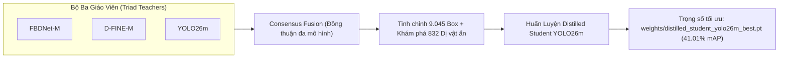

# 🛠️ Hướng Dẫn Huấn Luyện & Đánh Giá Mô Hình (Training & Evaluation Guide)

Tài liệu hướng dẫn chi tiết quy trình chuẩn bị dữ liệu, huấn luyện các dòng mô hình đơn lẻ, chưng cất tri thức (Knowledge Distillation) và đánh giá hiệu năng trên tập kiểm thử độc lập.

---

## 1. Chuẩn Bị Môi Trường & Dữ Liệu

### Cài đặt môi trường:
```bash
python -m pip install -e ".[app,dev]"
```

### Cấu trúc dữ liệu yêu cầu:
Dữ liệu huấn luyện tuân thủ cấu trúc chuẩn YOLO/COCO với 3 phân chia (`train`, `valid`, `test`). Định danh 5 phân lớp khuyết tật mục tiêu:
`0: DiVat`, `1: DiVatLoiLom`, `2: LoiChi`, `3: LoiNhua`, `4: LoiTray`.

Tiền xử lý bảo toàn tỷ lệ khung hình qua vùng quan tâm (ROI):
* Ảnh gốc: $5328 \times 3000$ pixel.
* Vùng ROI kính: $3980 \times 3000$ pixel (cắt bỏ phần biên cơ khí không chứa phôi).

---

## 2. Huấn Luyện Dòng Mô Hình CNN (YOLO26m & YOLO11m)

Huấn luyện mô hình YOLO trực tiếp qua CLI tích hợp:

```bash
# Huấn luyện YOLO26m với Varifocal Loss (VFL) và ROI tiền xử lý
python scripts/train.py train \
    --data data/processed/runtime_data.yaml \
    --config configs/train_yolo26m.yaml \
    --project-dir artifacts/runs

# Đánh giá chỉ số COCO trên tập Test độc lập
python scripts/train.py evaluate \
    --data data/processed/runtime_data.yaml \
    --weights weights/yolo26m_roi_vfl_best.pt \
    --output artifacts/evaluation/yolo26m_eval.json
```

---

## 3. Huấn Luyện D-FINE-M & FBDNet-M (DETR Transformer)

D-FINE và FBDNet yêu cầu runtime tùy biến đặt tại `results/D-FINE/` cùng cấu hình mở rộng:

### 3.1. D-FINE-M Baseline:
```bash
python scripts/train.py train-dfine \
    --data data/processed/runtime_data.yaml \
    --dfine-repo results/D-FINE \
    --weights weights/dfine_m_baseline_reproduced_best.pth \
    --output-dir artifacts/runs/dfine_m \
    --epochs 100 \
    --batch-size 4
```

### 3.2. FBDNet-M (Boundary-Aware & Scale-Aware NWD):
FBDNet tích hợp mô-đun trích xuất đặc trưng biên (AFTA, SFIF, DCFSB) và hàm mất mát Scale-Aware Normalized Wasserstein Distance (SANWD):
```bash
python scripts/train_fbdnet.py \
    --exp e1 \
    --weights weights/dfine_m_fbdnet_best.pth \
    --epochs 20 \
    --batch-size 8 \
    --device cuda \
    --output-dir runs/fbdnet_nwd
```

---

## 4. Chưng Cất Tri Thức Học Sinh - Giáo Viên (Knowledge Distillation)

Quy trình chưng cất tri thức chuyển giao khả năng nhận diện vượt trội từ bộ ba Giáo viên dị thể (`Adaptive Heterogeneous Triad`) sang mô hình Học sinh siêu nhẹ `YOLO26m`:



### Các bước thực thi chưng cất:
1. **Sinh nhãn đồng thuận (Consensus Pseudo-Labels):**
   * Sử dụng WBF kết hợp 3 mô hình giáo viên để hiệu chỉnh tọa độ nhãn gốc với độ chính xác dưới pixel (Sub-pixel Ground Truth Refinement).
   * Khám phá các dị vật ẩn bị bỏ sót trong nhãn gốc khi có từ 2 giáo viên trở lên xác nhận với độ tin cậy $\ge 0.35$.
2. **Huấn luyện học sinh với hàm mất mát kết hợp:**
   * Áp dụng `Varifocal Loss (VFL)` kết hợp `Inverse-Frequency Class Weights` để trừng phạt lỗi phân loại trên các khuyết tật thiểu số.
3. **Kết quả đạt được:**
   * Trọng số lưu trữ tại: [`weights/distilled_student_yolo26m_best.pt`](file:///D:/HOCsauvaufngdung/scale-error-yolo26/weights/distilled_student_yolo26m_best.pt).
   * Đạt **41.01% mAP@50:95** (+0.92% gain so với baseline đơn, +3.50% trên dị vật nhỏ) trong khi giữ nguyên tốc độ **~48.3 FPS (20.7 ms)**.

---

## 5. Quy Trình Đánh Giá Kiểm Định Toàn Diện (Full Evaluation Protocol)

Để đảm bảo tính khách quan và nhất quán trong toàn bộ các phép đo:
* **Tập kiểm thử:** 890 ảnh độc lập (chưa từng xuất hiện trong quá trình huấn luyện hay chưng cất).
* **Số lượng ground-truth box:** 1.573 box sau khi áp dụng ROI.
* **Định dạng tính toán:** COCO standard (`COCOeval`, tính mAP tại 10 ngưỡng IoU từ 0.50 đến 0.95 với bước nhảy 0.05).

### Lệnh chạy đánh giá phân tích toàn diện & kiểm định:
```bash
# Đánh giá kiểm định WBF định tuyến theo hình thái khuyết tật
python scripts/eval_morphology_wbf.py

# Phân tích cắt bỏ thành phần (Ablation), Bootstrap 95% CI và trích xuất chỉ số
python scripts/run_comprehensive_ablation_and_analysis.py
```

### Lệnh chạy kiểm định chuyên sâu FBDNet:
```bash
python scripts/evaluate_fbdnet_full.py --device cuda --output artifacts/evaluation/fbdnet_m
```
