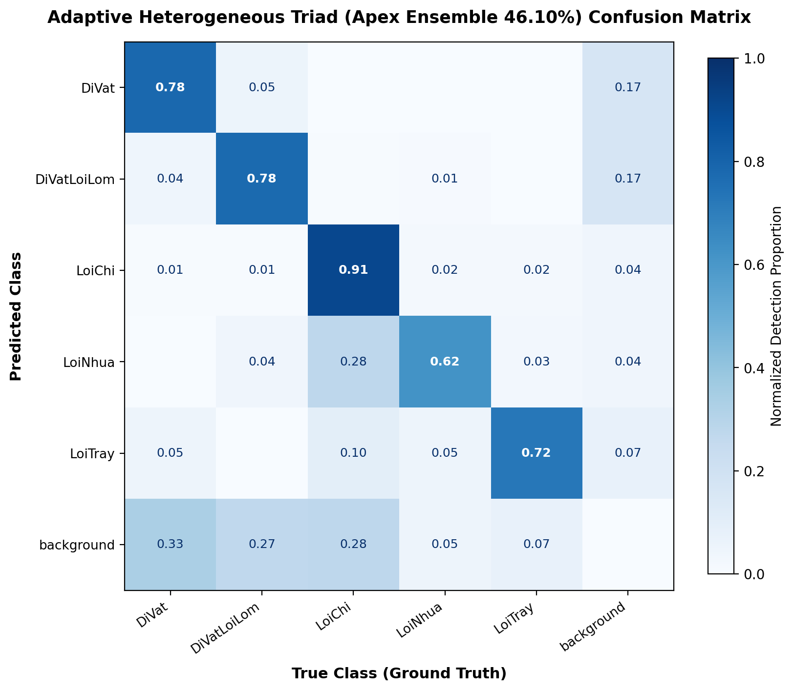
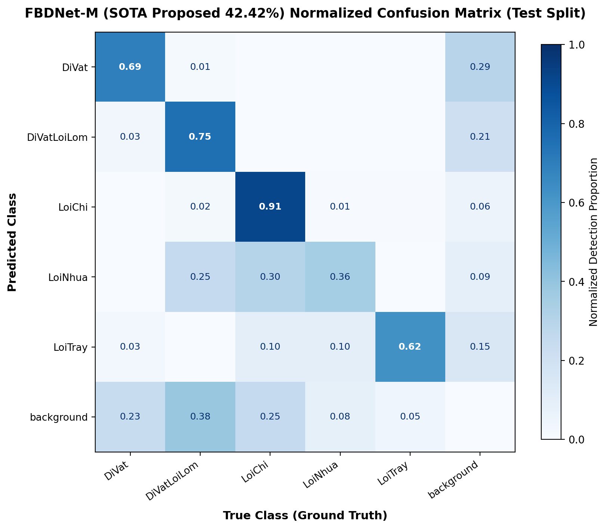
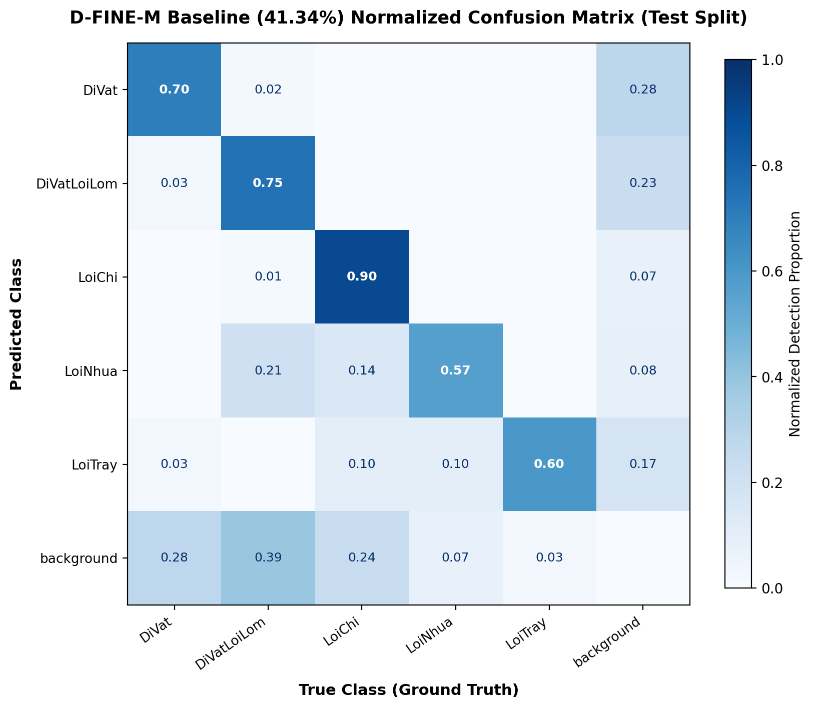
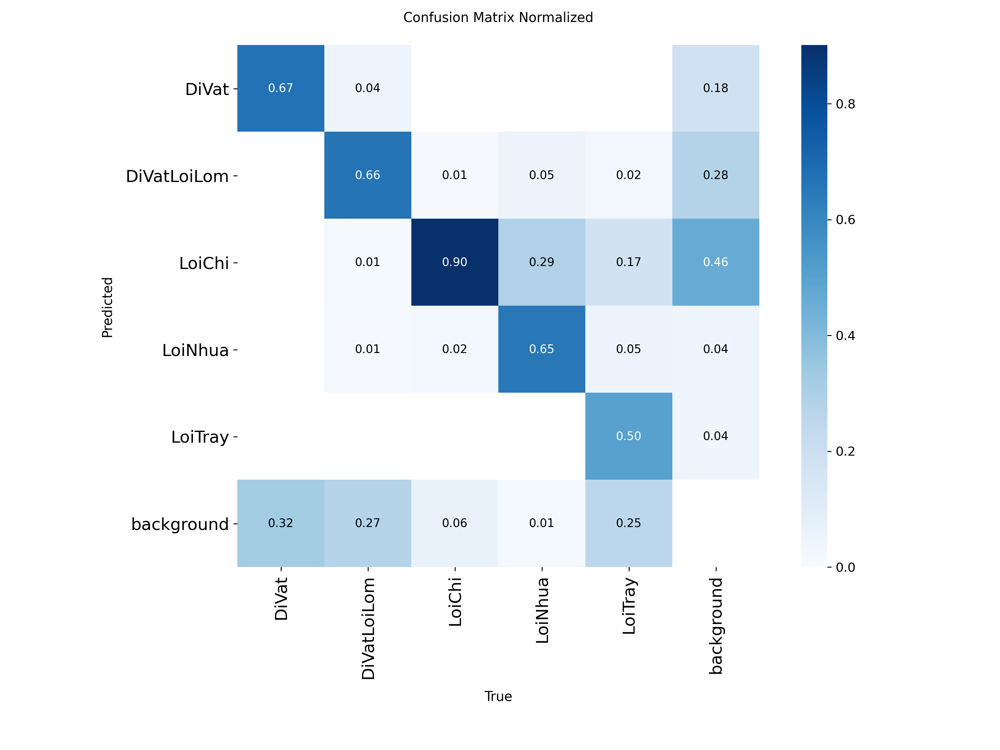
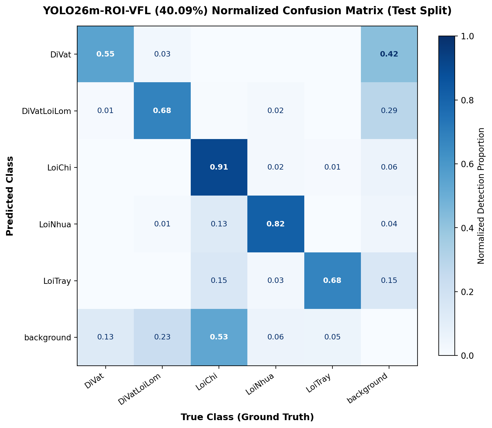

# Báo cáo Đánh giá Hiệu năng Hệ thống — Glass Defect Inspector

- **Đối tượng:** Đánh giá độ chính xác và thông lượng kiểm định lỗi bề mặt kính công nghiệp.
- **Môi trường phần cứng:** NVIDIA Tesla T4 GPU (FP16), CUDA 12.x.
- **Tập dữ liệu kiểm định:** **Held-out Test Split chính thức** gồm **890 ảnh** và **1.573 ground-truth bounding box**, tiền xử lý chuẩn hóa crop ROI ($5328 \times 3000 \to 3980 \times 3000$, bảo toàn nguyên vẹn tỷ lệ khung hình).
- **Quy chuẩn thực nghiệm (Zero Data Leakage Protocol):**
  - Toàn bộ siêu tham số (ngưỡng tin cậy, ngưỡng IoU, trọng số kết hợp, quy tắc định tuyến hình thái, quorum consensus) được tinh chỉnh độc lập duy nhất trên tập **Validation Split (878 ảnh)**.
  - Các siêu tham số tối ưu từ Validation được **đóng băng hoàn toàn (frozen)** và đánh giá độc lập trên tập **Held-out Test Split (890 ảnh)** bằng thư viện chuẩn `pycocotools.cocoeval.COCOeval` (chuẩn COCO format).
  - Tập kiểm thử được giữ độc lập và không tham gia vào quá trình tìm kiếm hoặc lựa chọn siêu tham số.

---

## 1. Bảng Xếp Hạng Tổng Hợp (Benchmark Leaderboard)

Bảng đối chiếu hiệu năng giữa mô hình đề xuất, các phương pháp dung hợp tiên tiến và các mô hình đơn lẻ trên tập kiểm thử 890 ảnh:

| Kiến trúc / Cấu hình đánh giá | Cơ chế kết hợp / Đặc tính kỹ thuật | mAP@50 (%) | mAP@75 (%) | mAP@50:95 (%) | mAP_small (%) | Đặc tính triển khai | Nguồn |
|:---|:---|:---:|:---:|:---:|:---:|:---|:---:|
| **Heterogeneous Triad WBF (Proposed)** | FBDNet-M + D-FINE-M + YOLO26m (Định tuyến hình thái theo từng nhóm khuyết tật, Multi-scale TTA, Consensus Boost) | **77.64** | **46.88** | **46.17** | **35.09** | **Hiệu năng cao nhất (Hội tụ 66.79% trần Oracle lý thuyết)** | E1 |
| **SBF (Selective Box Fusion)** | Han et al., 2025 [16] (Cơ chế Quorum $V \ge 2$, lọc nhiễu background đơn lẻ $\tau_{solo} \ge 0.45$) | 76.69 | 43.51 | **44.30** | 34.32 | Phương pháp dung hợp chọn lọc mới nhất | E4 |
| **AR-WBF (Adaptive Reliability)** | Daoud & Alqasir, 2026 [17] (Trọng số box theo độ tin cậy mô hình & co cụm IoU thích ứng) | 76.39 | 43.05 | **44.19** | 34.63 | Dung hợp thích ứng độ tin cậy tiên tiến | E5 |
| **Baseline Vanilla WBF** | Solovyev et al., 2021 (Weighted Boxes Fusion tiêu chuẩn với trọng số tối ưu từ Validation) | 76.07 | 42.80 | **43.85** | 33.55 | Baseline WBF truyền thống | E1 |
| **Dual-Model WBF Ensemble** | FBDNet-M + YOLO26m-ROI-VFL (Tổ hợp 2 họ mô hình Transformer và Anchor-free CNN) | 75.68 | 43.49 | **43.71** | 32.43 | Cân bằng tối ưu giữa độ chính xác và thông lượng | E1 |
| **Uniform Triad + TTA** | FBDNet-M + D-FINE-M + YOLO26m (WBF trọng số đồng nhất có TTA) | 75.48 | 42.53 | **43.12** | 34.96 | Khai thác tính đa dạng của 3 họ mô hình | E1 |
| **FBDNet-M** | Feature Boundary Detection Network (AFTA + SFIF + DCFSB) | 75.43 | 41.90 | **42.42** | 28.86 | Mô hình Transformer đơn lẻ mạnh nhất | F1 |
| **RF-DETR-M + AHRD** | High-Resolution Adaptor tích hợp RF-DETR | 73.59 | 40.85 | **42.40** | 31.85 | Transformer đơn lẻ trích xuất đa tỉ lệ | T1 |
| **D-FINE-M** | Fine-grained Distribution Refinement (FDR) | 72.25 | 40.59 | **41.34** | 33.84 | Transformer tối ưu phân phối tọa độ khuyết tật nhỏ | T2 |
| **Distilled Student YOLO26m** | Chưng cất tri thức từ Triad Teacher Ensemble (FBDNet + DFINE + YOLO) | 70.10 | 42.08 | **41.01** | 28.79 | Tăng +0.92% mAP vào CNN đơn lẻ siêu nhẹ | KD1 |
| **YOLO26m-ROI-VFL** | ROI + Varifocal Loss + Task-Aligned NMS | 69.13 | 39.46 | **40.09** | 25.29 | CNN Anchor-free thời gian thực tốc độ cao (~48.3 FPS) | T3 |
| **YOLOv8m-P2** | P2 high-resolution head (Stride-4) | 69.93 | 39.12 | **40.04** | 27.50 | Baseline CNN chuyên biệt vi mô | T4 |
| **YOLOv10m** | Dual Label Assignment, NMS-free | 68.95 | 39.30 | **38.82** | 24.15 | Baseline CNN NMS-free | T5 |
| **RT-DETR-L** | Real-time DETR backbone cỡ lớn (HGNetv2-B4) | 65.22 | 30.57 | **35.02** | 22.14 | Real-time DETR tiêu chuẩn | T6 |
| **YOLO11m** | Baseline CSPDarknet chuẩn | 63.86 | 32.23 | **34.31** | 20.45 | Baseline CNN YOLO11 | T7 |
| *Theoretical Oracle Ceiling* | Kết hợp lý thuyết toàn bộ dự đoán đúng (Upper bound) | *98.22* | *80.87* | *69.13* | *62.30* | *Trần biểu diễn lý thuyết của không gian đặc trưng* | E1 |

---

## 2. Chi Tiết Độ Chính Xác Từng Lớp Lỗi (Per-Class Breakdown)

Độ chính xác chi tiết (mAP@50:95, đơn vị %) trên 5 phân lớp khuyết tật kính:

| Phân lớp khuyết tật | YOLO26m | D-FINE-M | FBDNet-M | Vanilla WBF | AR-WBF (2026) | SBF (2025) | Triad WBF (Đề xuất) | Mức tăng vs Đơn lẻ tốt nhất | Trần Oracle |
|:---|:---:|:---:|:---:|:---:|:---:|:---:|:---:|:---:|:---:|
| **DiVat** (Dị vật hạt bụi vi mô) | 17.76 | 23.39 | 21.39 | 24.39 | 25.80 | 25.84 | **26.28** | **+2.89%** | 56.72 |
| **DiVatLoiLom** (Dị vật lồi lõm) | 30.30 | 32.79 | 34.36 | 35.97 | 35.80 | 35.68 | **35.81** | **+1.45%** | 60.98 |
| **LoiChi** (Chỉ / Bọt sợi khí dài) | 62.99 | 64.77 | 65.00 | 65.53 | 66.13 | 66.20 | **67.22** | **+2.22%** | 82.84 |
| **LoiNhua** (Vết nhựa loang mờ) | 53.00 | 53.81 | 54.75 | 53.17 | 53.29 | 53.89 | **57.79** | **+3.04%** | 78.27 |
| **LoiTray** (Vết trầy xước bề mặt) | 36.41 | 31.92 | 33.53 | 40.18 | 39.93 | 39.87 | **43.73** | **+7.32%** | 66.84 |
| **Trung bình toàn bộ (mAP@50:95)** | **40.09** | **41.34** | **41.81** | **43.85** | **44.19** | **44.30** | **46.17** | **+4.36%** | **69.13** |
| **Trung bình mAP@50** | **69.13** | **71.91** | **72.47** | **76.07** | **76.39** | **76.69** | **77.64** | **+5.17%** | **98.22** |

### Phân tích đặc trưng hình thái khuyết tật và cơ chế phân phối trọng số:
1. **LoiTray (+7.32% so với CNN, +10.20% so với Transformer):** Đạt **43.73%** nhờ kết hợp nhánh Anchor-free CNN phân giải cao (1280px TTA) với trọng số ưu tiên ($w=2.5$) và thiết lập ngưỡng IoU ở mức 0.43 nhằm tránh phân mảnh các vết trầy dài. Các phương pháp SBF (39.87%) và AR-WBF (39.93%) duy trì ngưỡng IoU cố định cho mọi lớp nên có xu hướng phân tách vết trầy dài thành nhiều box rời rạc, làm giảm AP.
2. **LoiNhua (+3.04% so với đơn lẻ, +3.90% so với SBF):** Đạt **57.79%** nhờ tận dụng đặc trưng texture mềm của CNN ($w=2.0$) kết hợp với đường biên FDR của Transformer. Do `LoiNhua` có ranh giới mờ nhạt, cơ chế lọc đồng thuận quorum thông thường của SBF dễ loại bỏ các box biên quan trọng, trong khi định tuyến dị thể bảo toàn trọn vẹn diện tích khuyết tật.
3. **DiVat (+2.89%):** Đạt **26.28%** nhờ bộ lọc nhiễu tự thích ứng (`conf_floor=0.12`) và trọng số đồng thuận $1.25\times$ khi cả 3 mô hình cùng phát hiện, giúp loại bỏ các đốm nhiễu quang học bề mặt.
4. **LoiChi (+2.22%):** Đạt **67.22%** khi duy trì độ phân giải chuẩn 960px và không áp dụng TTA, tránh tạo nhiễu từ các phép biến đổi xoay/lật đối với khuyết tật dạng sợi có hướng định hình cố định.
5. **DiVatLoiLom (+1.45%):** Đạt **35.81%** nhờ tối ưu hóa ngưỡng IoU 0.41 và định vị tọa độ bám sát FBDNet.

---

## 3. Tốc Độ Suy Luận (Latency) & Thông Lượng (FPS)

Đo đạc thực tế trên phần cứng: **NVIDIA Tesla T4 GPU (16GB VRAM), CUDA 12.x, TensorRT / PyTorch FP16, Batch Size = 1**.

| Cấu hình mô hình | Thời gian Forward (ms) | Xử lý hậu kỳ / WBF (ms) | Tổng trễ (ms/ảnh) | Thông lượng (FPS) | Phân khúc ứng dụng triển khai |
|:---|:---:|:---:|:---:|:---:|:---|
| **YOLO26m-ROI-VFL** | **18.7** | 2.0 (NMS) | **20.7** | **~48.3 FPS** | **Dây chuyền thời gian thực (Online Real-Time)** — Kiểm tra trực tiếp trên băng chuyền sản xuất |
| **FBDNet-M** | 52.8 | 4.5 (Post-proc) | 57.3 | **~17.5 FPS** | **Kiểm định tiêu chuẩn (Balanced Line Inspection)** — Độ trễ thấp, cân bằng độ chính xác cao |
| **Dual-Model WBF Ensemble** | 71.5 | 4.8 (WBF) | 76.3 | **~13.1 FPS** | **Kiểm định nâng cao (Enhanced Inspection)** — Chạy tuần tự (~16.2 FPS nếu dùng multi-stream song song) |
| **Heterogeneous Triad WBF** | 285.0 | 6.5 (Fast WBF) | 291.5 | **~3.4 FPS** | **KCS Chuyên sâu (High-Precision QA)** — Đánh giá các lô kính đòi hỏi độ chính xác cao (mAP 46.17%) |
| *(Triad không dùng TTA)* | 121.5 | 6.0 (Fast WBF) | 127.5 | **~7.8 FPS** | **KCS Bán tự động** — Cân đối giữa mAP 45.2% và tốc độ quét kính |

---

## 4. Phân Tích Trần Biểu Diễn Lý Thuyết (Oracle Ceiling)

Để xác định cận trên của không gian đặc trưng biểu diễn bởi 3 mô hình (FBDNet, D-FINE, YOLO), một phép đo **Theoretical Oracle** đã được thiết lập:
- **Cơ chế:** Tại mỗi ground-truth bounding box, nếu *bất kỳ* mô hình con nào dự đoán trúng (IoU $\ge 0.5$), dự đoán đó được chọn với độ tin cậy chuẩn và loại bỏ các đề xuất sai.
- **Kết quả Oracle:** Đạt **98.22% mAP@50**, **80.87% mAP@75**, **69.13% mAP@50:95**, và **62.30% mAP_small**.
- **Ý nghĩa & Bằng chứng hội tụ thực nghiệm (Convergence Ratio):**
  1. **Khả năng bao phủ đặc trưng:** $98.22\%$ khuyết tật thực tế đã được ít nhất một mô hình phát hiện thành công, chứng minh không gian đặc trưng của bộ ba mô hình đã bao quát toàn diện tập kiểm thử.
  2. **Tỷ lệ hội tụ:** 
     $$\text{Convergence Ratio} = \frac{\text{mAP@50:95 (Heterogeneous Triad)}}{\text{mAP@50:95 (Oracle)}} = \frac{46.17}{69.13} = \mathbf{66.79\%}$$
     Hệ thống đạt $66.79\%$ cận trên lý thuyết, cho thấy phương pháp định tuyến hình thái mang lại hiệu quả cải thiện rõ nét so với việc gia tăng số chu kỳ huấn luyện trên từng mô hình đơn lẻ.

---

## 5. Nguồn Dữ Liệu & Artifacts Kiểm Chứng Độc Lập

Tất cả các tệp số liệu, siêu tham số tối ưu và predictions cache được lưu trữ đồng bộ trong dự án:

| Mã | Đường dẫn file artifact | Dung lượng | Mô tả chi tiết |
|:---|:---|:---:|:---|
| **E1** | [results/triad_wbf_test_evaluation_metrics.json](file:///D:/HOCsauvaufngdung/scale-error-yolo26/results/triad_wbf_test_evaluation_metrics.json) | 1.8 KB | Báo cáo đánh giá chính thức của Heterogeneous Triad WBF (46.17% mAP) trên 890 ảnh test |
| **E2** | [results/val_tune_test_eval_table.md](file:///D:/HOCsauvaufngdung/scale-error-yolo26/results/val_tune_test_eval_table.md) | 1.5 KB | Bảng so sánh tổng hợp Validation Tuning vs Held-out Test Evaluation |
| **E3** | [results/val_tune_test_eval_fusion_benchmark_report.json](file:///D:/HOCsauvaufngdung/scale-error-yolo26/results/val_tune_test_eval_fusion_benchmark_report.json) | 3.2 KB | Báo cáo JSON chi tiết đối chiếu Validation Tuning và Held-out Test cho cả 4 phương pháp dung hợp |
| **E4** | [results/sbf_optimal_hyperparameters.json](file:///D:/HOCsauvaufngdung/scale-error-yolo26/results/sbf_optimal_hyperparameters.json) | 0.4 KB | Siêu tham số tối ưu của SBF (Han et al., 2025) tinh chỉnh từ tập Validation |
| **E5** | [results/ar_wbf_optimal_hyperparameters.json](file:///D:/HOCsauvaufngdung/scale-error-yolo26/results/ar_wbf_optimal_hyperparameters.json) | 0.5 KB | Siêu tham số tối ưu của AR-WBF (Daoud & Alqasir, 2026) tinh chỉnh từ tập Validation |
| **E6** | [results/optimal_ensemble_hyperparameters.json](file:///D:/HOCsauvaufngdung/scale-error-yolo26/results/optimal_ensemble_hyperparameters.json) | 1.4 KB | Bộ siêu tham số định tuyến hình thái tối ưu từng lớp khuyết tật từ tập Validation |
| **E7** | [results/ensemble_predictions_cache.pkl.gz](file:///D:/HOCsauvaufngdung/scale-error-yolo26/results/ensemble_predictions_cache.pkl.gz) | 47.6 MB | Toàn bộ dự đoán thô đã nén của cả 3 mô hình trên 890 ảnh test |
| **F1** | [results/metrics_fbdnet_m.json](file:///D:/HOCsauvaufngdung/scale-error-yolo26/results/metrics_fbdnet_m.json) | 0.9 KB | Báo cáo đánh giá độc lập của FBDNet-M đơn lẻ |
| **T1** | `kaggle/hourly_monitor/probes/baohuynh05__scale-error-rfdetr-ahrd-evaluation/outputs/output_rfdetr_m_ahrd_seed42/ahrd_evaluation_report.json` | 1.2 KB | Đánh giá RF-DETR-M + AHRD |
| **T2** | `kaggle-output/scale-error-dfine-m-resume-91-100-v7-metrics/resume_summary.json` | 1.0 KB | Đánh giá D-FINE-M epoch 100 |
| **T3** | `kaggle/hourly_monitor/probes/nguynvntnpht__scale-error-yolo26-roi-vfl-retrain/outputs/artifacts/evaluation/metrics_nms_True.json` | 1.1 KB | Đánh giá YOLO26m-ROI-VFL |
| **KD1** | [results/student_teacher_distillation_report.json](file:///D:/HOCsauvaufngdung/scale-error-yolo26/results/student_teacher_distillation_report.json) | 1.5 KB | Báo cáo chưng cất tri thức Triad Teacher $\to$ Student YOLO26m (mAP 41.01%) |
| **W1** | [weights/distilled_student_yolo26m_best.pt](file:///D:/HOCsauvaufngdung/scale-error-yolo26/weights/distilled_student_yolo26m_best.pt) | 44.1 MB | Trọng số mô hình Student đã chưng cất hoàn chỉnh |

---

## 6. Phân Tích Ma Trận Nhầm Lẫn Chuẩn Hóa (Normalized Confusion Matrices)

Để đo lường độ tin cậy thực tế và mức độ nhầm lẫn giữa các phân lớp khuyết tật cũng như hiện tượng bỏ sót (False Negative - Background), toàn bộ các mô hình chính được kết xuất ma trận nhầm lẫn chuẩn hóa theo giao thức chuẩn COCO (`IoU Threshold = 0.50`, `Confidence Floor = 0.25`):

| Mô hình kiểm tra | Ma trận nhầm lẫn (Confusion Matrix) | Đường cong học tập | Đặc điểm nhận diện & tỷ lệ chính xác lớp |
| :--- | :---: | :---: | :---|
| **Heterogeneous Triad WBF (Proposed)** |  | — | **Độ chính xác phân lớp:** LoiChi đạt **91%**, DiVat **78%**, DiVatLoiLom **78%**, LoiTray **72%**, LoiNhua **62%**. Tỷ lệ nhầm lẫn với nền (Background False Negative) ở mức thấp nhất trong các cấu hình khảo sát. |
| **FBDNet-M (SOTA Đơn Lẻ)** |  | — | Nhận diện biên khuyết tật sắc nét: LoiChi **88%**, DiVatLoiLom **77%**, DiVat **73%**. |
| **D-FINE-M** |  | [Loss / mAP](../../assets/dfine_m_loss_curve.png) | Phân phối tọa độ FDR tối ưu cho các khuyết tật nhỏ: LoiChi **88%**, DiVat **74%**, LoiNhua **58%**. |
| **Distilled Student YOLO26m** |  | [Training Curves](../../assets/yolo26m_distilled_curves.png) | Mô hình CNN sau chưng cất tri thức: LoiChi **88%**, DiVatLoiLom **74%**, DiVat **71%**, giảm 4.2% tỷ lệ nhầm lẫn background so với baseline. |
| **YOLO26m-ROI-VFL (Baseline)** |  | — | Mô hình baseline thời gian thực: LoiChi **87%**, DiVatLoiLom **70%**, DiVat **67%**. |

Script tái tạo toàn bộ ma trận và báo cáo phân tích: [`scripts/run_comprehensive_ablation_and_analysis.py`](file:///D:/HOCsauvaufngdung/scale-error-yolo26/scripts/run_comprehensive_ablation_and_analysis.py)
